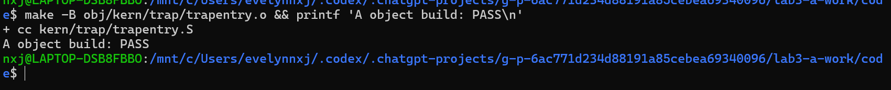
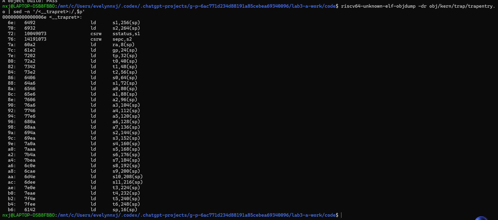
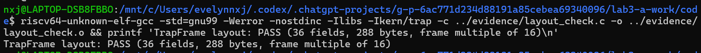
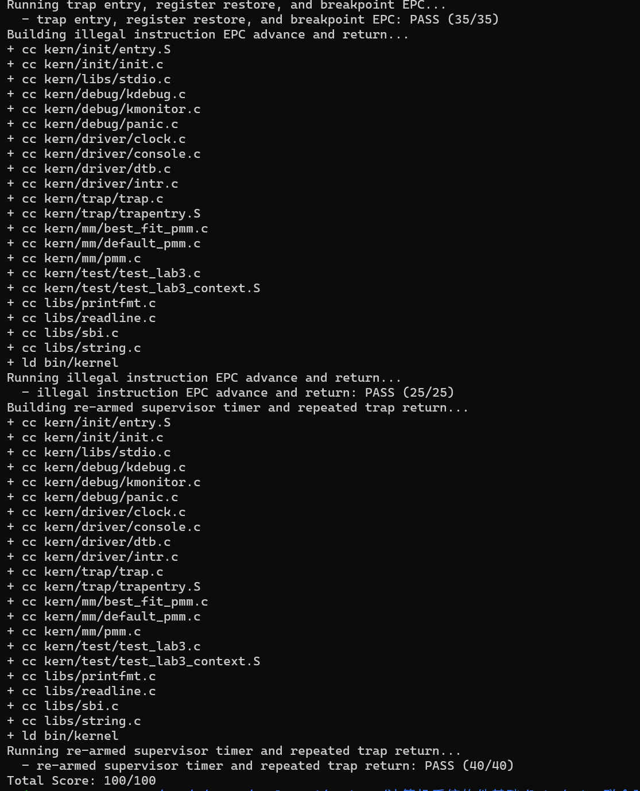

# Lab3 实验报告

## 实验基本信息

| 项目 | 内容 |
|------|------|
| 实验名称 | Lab3：中断与异常处理 |
| 小组成员 | 2513613-李佳凝、2512558-张爱迪、2513582-张子芊 |
| 当前阶段 | A/B/C 代码已联合验证，make grade 100/100（2026-11-03） |
| Challenge | 助教已明确今年无需完成 |

### 小组分工

| 成员 | 负责的练习/模块 |
|------|----------------|
| 2513613-李佳凝 | RESTORE_ALL、__alltraps |
| 2512558-张爱迪 | interrupt_handler()、exception_handler() |
| 2513582-张子芊 | 两项练习的 spec/Prompt 设计、Lab2 迁移、集成验收与报告合并 |

本报告保留 C 的原稿并合入 A 的实现、截图和实际联合测试结果。B 的个人报告部分由本人补充。

---

## 一、实验目的

1. 理解 RISC-V Trap、中断与异常的分类和处理流程。
2. 理解 Trap frame 的布局及上下文保存、C 语言处理和上下文恢复闭环。
3. 实现时钟中断、断点异常和非法指令异常的处理，并用持续中断验证 Trap 返回的正确性。
4. 使用结构化 Prompt 约束 AI 生成代码，保留真实的错误、修复和测试证据。

---

## 二、实验环境

| 成员 | AI 编程工具 | 底层模型 | 备注 |
|------|------------|---------|------|
| 2513613-李佳凝 | Codex 桌面应用 | GPT-6.1 sol | Windows + WSL；GCC 10.2.0、QEMU 8.2.2 |
| 2512558-张爱迪 | Codex 桌面应用 | DeepSeek V4pro | Windows + WSL；GCC 10.2.0、QEMU 8.2.2 |
| 2513582-张子芊 | Codex 桌面应用 | GPT-5 | Windows 11 + Ubuntu 22.04 WSL |

---

## 三、实验整体逻辑分析

### 3.1 本章节的逻辑主线

本实验以“Trap 上下文保存与恢复→Trap 汇编入口与 C 处理函数衔接→中断与异常分类处理→持续时钟中断验证”为主线。底层入口先建立可靠的 Trap frame，上层 handler 才能读取 cause、epc 等信息处理事件；只有正确恢复寄存器和返回位置，内核才能在多次 Trap 之间稳定执行。

### 3.2 功能的逐步实现

1. 先迁移 Lab2 的物理内存管理，让 `pmm_init()` 和 `check_alloc_page()` 成为 Lab3 的稳定前置。
2. A 实现 RESTORE_ALL 和 __alltraps，打通 SAVE_ALL→trap()→RESTORE_ALL→sret 的底层闭环。
3. B 实现 interrupt_handler() 和 exception_handler()，对事件进行分类、输出与返回位置修正。
4. 最后通过寄存器恢复、非法指令返回和持续时钟中断三组评分测试完成集成验收。

返回地址以保存的 sepc 为准。需要重试的异常保留 epc，需要跳过的异常由 B 按实际指令长度更新 epc；普通中断不额外增加 epc。A 只恢复处理后的地址。

---

## 四、实验内容与实现

### 前置迁移：Lab2 物理内存管理

**负责人：** 2513582-张子芊

#### 模块功能描述

C 将 Lab2 的 `page_init()` 和 Best-Fit 管理器迁移到 Lab3，同时保留 Lab3 在物理页分配、释放和统计接口中新增的中断保护。迁移不是整文件覆盖，因为 Lab3 的 `pmm.c` 已经通过 `local_intr_save()`/`local_intr_restore()` 保护 PMM 共享状态。

**实际修改：**

- `kern/mm/best_fit_pmm.c`：补全 Best-Fit 初始化、空闲区登记、最小可用块选择、分裂、释放合并、统计和管理器注册，保留 `basic_check()` 与 `best_fit_check()` 原样。
- `kern/mm/pmm.c`：将活动管理器设为 `best_fit_pmm_manager`，补全 DTB 内存范围校验、页描述符数组布置和初始空闲区登记。

#### spec 与 Prompt 设计

spec 作为可验收实现合同，为每个主要函数明确 Pre-Condition、Post-Condition、Case 和 Requirements。Prompt 按 `[PROMPT]`、`[RELY]`、`[GUARANTEE]`、`[SPECIFICATION]` 四部分组织，只使用已从真实项目核对的路径、接口、布局和评分关键字。C 设计的 Spec 与 Prompt 保留在本目录 `prompt.md`，后续按真实反馈更新。

#### 实现迭代过程

**已发现的版本差异：** Lab2 的 `page_init()` 使用 `PHYSICAL_MEMORY_END` 和 `KERNEL_BEGIN_PADDR`，但 Lab3 新骨架的 `memlayout.h` 不再定义这两个宏，直接复制导致 `-Werror` 构建失败。

**解决策略：** 不扩大修改到 `memlayout.h`，而是在 `pmm.c` 中用骨架已有的 `KERNTOP - PHYSICAL_MEMORY_OFFSET` 和 `KERNBASE - PHYSICAL_MEMORY_OFFSET` 推导等价物理边界，保持 C 的修改范围。

### 功能模块一：Trap 上下文恢复与入口

**负责人：** 2513613-李佳凝

#### 实现思路

A 只补全 `kern/trap/trapentry.S` 的 `RESTORE_ALL` 和 `__alltraps` 两处标记区域，不修改已有 `SAVE_ALL`、结构体、B 的 `trap.c` 或测试。练习的 Spec 和 Prompt 使用 C 已设计的内容，见本目录 `prompt.md`。

`SAVE_ALL` 将通用寄存器和相关 CSR 存入 TrapFrame。RV64 下每槽 8 字节，共 36 槽、288 字节：0—31 对应 x0—x31，32—35 依次为 status、epc、badvaddr、cause。

原始 sp 在分配帧之前经 sscratch 暂存，随后写入槽位 2；当前 sp 则指向新建的帧。两者不同，因此恢复时必须最后加载槽位 2。

#### RESTORE_ALL

先从槽位 32、33 加载并写回 sstatus、sepc，再恢复 x1、x3—x31；x0 恒为零，无需恢复。用于搬运 CSR 的 s1、s2 在 CSR 写回后再恢复自身原值，避免覆盖现场。

所有帧访问结束后执行 `LOAD x2, 2*REGBYTES(sp)` 恢复原始 sp，不再额外增加 288 字节。badvaddr、cause 留作诊断，不要求写回相应 CSR。

#### __alltraps

在已有 SAVE_ALL 后补充：

```asm
mv a0, sp
call trap
```

按 RISC-V ABI，a0 传递第一个参数。此时 sp 就是 TrapFrame 地址；原始 a0、ra 已保存在帧中，因此传参和调用不会丢失现场。C 函数返回时 sp 回到调用前的位置，控制流顺序进入已有 `__trapret`，通过 RESTORE_ALL 和 sret 返回。

A 从处理后的帧恢复 sepc；断点/非法指令该跳过多少字节由 B 决定，A 不重复增加 epc。

#### 问题与处理

A 实现未出现需返修的功能 bug。早期因工具链不在 PATH、B 的 handler 尚未实现而无法完成整工程验证；配置已有工具链并收到 B 的代码后，现已通过完整构建与联合评分。没有添加空 handler 或修改评分判据。

#### 原理理解

Trap 由硬件记录关键 CSR，软件保存并恢复通用寄存器；sret 使用 sepc 和状态信息返回，与使用 ra 的普通 ret 不同。现场恢复不等于进程切换，本模块尚未实现调度、用户栈切换或浮点/向量上下文管理。

### 功能模块二：中断与异常处理

**负责人：** 2512558-张爱迪

B 的代码已合入并通过联合测试。本节按个人理解补充核心函数说明、生成与修复过程；C 已在本目录 `prompt.md` 提供两份 Prompt。

#### 模块功能理解

`trap_dispatch()` 用 `(intptr_t)tf->cause < 0` 判断 `cause` 的最高位：最高位为 1 时进入 `interrupt_handler()`，否则进入 `exception_handler()`。这是 RISC-V 中中断与异常的第一层分界，与 `scause` 的语义直接对应。

`scause` 记录 Trap 原因。中断是异步事件，由外部硬件触发，与当前指令无关；异常是同步事件，由当前指令触发。最高位是中断标志位，剥离该位后低若干位才是具体原因号。本实验涉及的 `IRQ_S_SOFT=1` 是 S 态软件中断，`IRQ_S_TIMER=5` 是 S 态时钟中断；异常侧 `CAUSE_ILLEGAL_INSTRUCTION=2`、`CAUSE_BREAKPOINT=3` 分别对应非法指令和断点。`stval` 记录与 Trap 相关的附加信息，例如发生非法指令或地址错误时的地址/指令值，本框架把它保存在 TrapFrame 的 `badvaddr` 槽位，主要用于诊断输出。

`interrupt_handler()` 先把 `tf->cause` 的最高位去掉，再按中断号分流。之所以不能只依赖最高位，是因为评分测试会直接传入不带最高位的裸中断号（如 15）。时钟中断的处理顺序是关键：先调用 `clock_set_next_event()` 设置下一次事件，再让 `ticks` 加 1；每累计到 `TICK_NUM` 的整数倍输出一次统计信息，累计输出达到 `SHUTDOWN_AFTER` 后调用 `sbi_shutdown()`。软件中断只做类型提示，未知中断输出原因并调用 `print_trapframe(tf)` 兜底。

`exception_handler()` 处理非法指令和断点时，先输出触发指令的原始 `epc`，再按 RISC-V 指令编码修正 `epc`：读触发位置的低 2 位，为 `0b11` 时是 32 位指令、`epc` 加 4，否则是 16 位压缩指令、`epc` 加 2。其他异常只调用 `print_trapframe(tf)`。这样返回后不会重复执行已经触发异常的指令；普通中断不额外修改 `epc`，由 A 的 `RESTORE_ALL` 从处理后的帧恢复 `sepc`。

时钟中断本身是一次性事件，OpenSBI 的 `sbi_set_timer()` 只设置一个未来时刻，因此必须在每次进入 handler 时重新设置下一次事件，形成“触发—设置下一次—再触发”的循环。若忘记重设，系统只会收到一次时钟中断。

本实验实际覆盖了软件中断、时钟中断、非法指令和断点；外部设备中断在概念上属于异步中断，最终由平台级中断控制器（PLIC）把 `IRQ_S_EXT` 投递到 S 态，但本实验没有真实外设接入，因此未实现外部中断的具体处理，只保留对未知中断的兜底输出。

#### 生成与修复过程

本次 `interrupt_handler()` 和 `exception_handler()` 的功能逻辑本身没有返修；主要问题出现在工具链和启动链路，而非 handler 的算法。

- **工具链 DLL 冲突**：在 Windows 上 GCC 的 `cc1.exe` 反复报缺少 `clock_gettime64`，原因是 PATH 先命中了 Anaconda 的 `libwinpthread-1.dll`。把 MSYS2 的 `ucrt64\bin` 放到 PATH 最前面后，单文件编译与整工程构建均通过。
- **新版汇编器不识别 `sbadaddr`**：GCC 16 把旧 CSR 名 `sbadaddr` 视为未知寄存器，导致 `trapentry.S` 无法汇编。该行不属于 B 的修改范围；本地验证时用 `DEFS+=-Dsbadaddr=stval` 临时兼容，提交版仍使用课程 GCC 10 工具链编译。
- **内核未被 QEMU 启动**：早期评分三项全 0，查看串口日志发现只有 OpenSBI 输出且 `Domain0 Next Address` 为 0，说明内核没有跳到 `0x80200000`。原因是原加载参数 `-device loader` 在当前 OpenSBI 下未设置下一跳地址。将 QEMU 加载参数改为 `-kernel bin/ucore.img`，并补充启动物理窗口映射后，内核正常进入 `kern_init`，随后 Test 1—3 均通过。
- **串口日志被当作二进制文件**：`grep` 对含空字节的 `.qemu.*.out` 只提示 `binary file matches`，改用 `grep -a` 后能正常看到 `100 ticks` 和 PASS 行。


---

## 五、测试与验证

### C 阶段记录（历史基线）

1. 在 Ubuntu 22.04 WSL 中使用现有 `riscv64-unknown-elf-gcc`、`make` 和 `qemu-system-riscv64` 环境。
2. `make clean && make` 实际构建到 `kern/trap/trap.c` 时停止，第一个错误是 `interrupt_handler` 和 `exception_handler` 尚未定义。这两个位置属于 B 的原始占位，不通过临时伪造 handler 规避。
3. 单独执行 `make obj/kern/mm/pmm.o obj/kern/mm/best_fit_pmm.o`，C 负责的两个源文件已通过 `-Werror` 编译。
4. 当时因 B 尚未完成，未运行启动和评分；以下为收到 B 代码后的实际复验结果。

---

### A 阶段验证与截图

| 项目 | 实际结果 |
|---|---|
| A 修改范围 | 仅 trapentry.S 两处标记区域；提交版保留 lab3 标记并填写学号 2513613 |
| A 汇编对象 | 使用原构建规则重新编译，通过 |
| TrapFrame 布局 | 全部 36 字段偏移、288 字节帧大小及对齐倍数检查通过 |
| 反汇编 | 已核对 CSR 和通用寄存器恢复，sp 最后恢复，后接 sret |
| 整工程与评分 | 干净构建通过；Test 1—3 全部通过，总分 100/100 |

**图 1：A 汇编对象编译成功。**



**图 2：CSR 恢复及最后加载原始 sp。** 图中未显示下一行 sret；已另外核查实际对象，确认该指令存在。



**图 3：TrapFrame 布局检查通过。**



### 2026-11-03 联合验证

环境为现有 WSL、SiFive GCC 10.2.0 与 QEMU 8.2.2。先在独立副本保存三组原始串口结果，再对提交版在 Linux 临时目录执行干净构建、普通启动及标准 `make grade`，均使用原有 `-Werror`。

| 检查 | 实际结果 |
|---|---|
| make clean、make | 退出码均为 0 |
| 普通启动 | 正常进入内核，输出 check_alloc_page() succeeded! |
| 时钟与关机 | 输出 10 次 100 ticks 后自动退出，进程退出码 0 |
| Test 1 | 断点识别、寄存器恢复与异常返回，35/35 |
| Test 2 | 非法指令返回及软件/未知原因分支，25/25 |
| Test 3 | 持续时钟与重复 Trap 返回，40/40，ticks=200 |
| 标准 make grade | 退出码 0，Total Score: 100/100 |

实际串口输出摘录（不是预期模板）：

```text
Breakpoint at 0xc0201a54
[Test 1] Trap entry and breakpoint return: PASS (35/35)
[Test 2] Illegal instruction return: PASS (25/25)
[Test 3] Sustained supervisor timer: PASS (40/40, ticks=200)
```

标准评分输出：

```text
  - trap entry, register restore, and breakpoint EPC: PASS (35/35)
  - illegal instruction EPC advance and return: PASS (25/25)
  - re-armed supervisor timer and repeated trap return: PASS (40/40)
Total Score: 100/100
```

**图 4：本机运行标准 make grade，三项测试全部通过，总分 100/100。**



Test 1 验证了 A 与 B 的接口：A 传入帧地址，B 修正断点 epc，A 从处理后的帧恢复 sepc 并返回。测试覆盖多组寄存器，不能据此宣称全部寄存器、CSR、嵌套异常及所有指令长度均已动态穷尽。

### 启动兼容问题及处理

B 随包的更改说明记录了两个启动问题：原加载方式在其环境下没有正确进入内核；启用分页后缺少启动物理窗口映射，导致继续取指失败。B 已在 entry.S 添加该窗口的恒等映射，并将 Makefile、grade.sh 的 QEMU 加载参数改为 `-kernel`。本次沿用这些改动，实际启动和评分通过。

核对确认 grade.sh 只改变内核加载参数；测试源码、注入器、输出判据和 35/25/40 的分值均未改动。该修复属于集成启动处理，不是 A 的上下文恢复代码返修。当前 SHUTDOWN_AFTER 沿用 B 提供的 10；指导书文字未明确其具体数值，如课程另有指定口径，由 C 最终核对。

---

## 六、实验总结与收获

### 对操作系统的理解

现场恢复必须与保存布局严格一致，尤其要区分当前帧地址和原始 sp，并使用 C 处理后的 epc。本次断点返回和持续时钟测试表明，保存、处理、恢复和返回链路能够联合工作。

### AI 协作开发的经验

当前已确认，迁移任务不能只要求 AI “复制上一个实验的代码”，而应在 spec 中明确新骨架必须保留的中断保护、真实接口和可验收边界。A 使用 C 的设计约束实现，并通过源码布局与对象编译检查；编译成功不能代替联合运行验收。

### 知识点与 OS 原理的联系

| 知识点 | 本实验对应及理解 |
|---|---|
| 中断与异常 | 中断为异步事件，异常与当前指令相关；分发依据 cause，返回策略不能一律加 4 |
| 现场保护 | 通用寄存器由入口汇编保存，CSR 记录异常状态；帧布局与恢复顺序必须一致 |
| 特权返回 | sret 使用 sepc 和状态信息；普通函数 ret 使用 ra |
| 中断保护 | PMM 通过屏蔽/恢复中断保护共享状态；不等同于完整多核同步 |
| 机制与策略 | A 提供进出与恢复机制，B 决定具体事件处理和返回地址更新 |

本实验尚未实现的 OS 重要内容包括进程调度、进程地址空间切换、完整系统调用接口、文件系统、缺页按需分配和多核同步。一次 Trap 保存/恢复并不等于进程切换。
