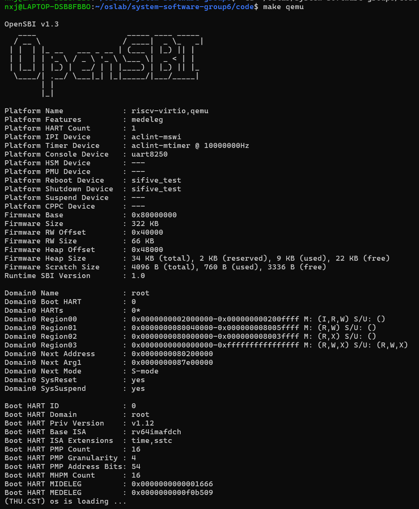
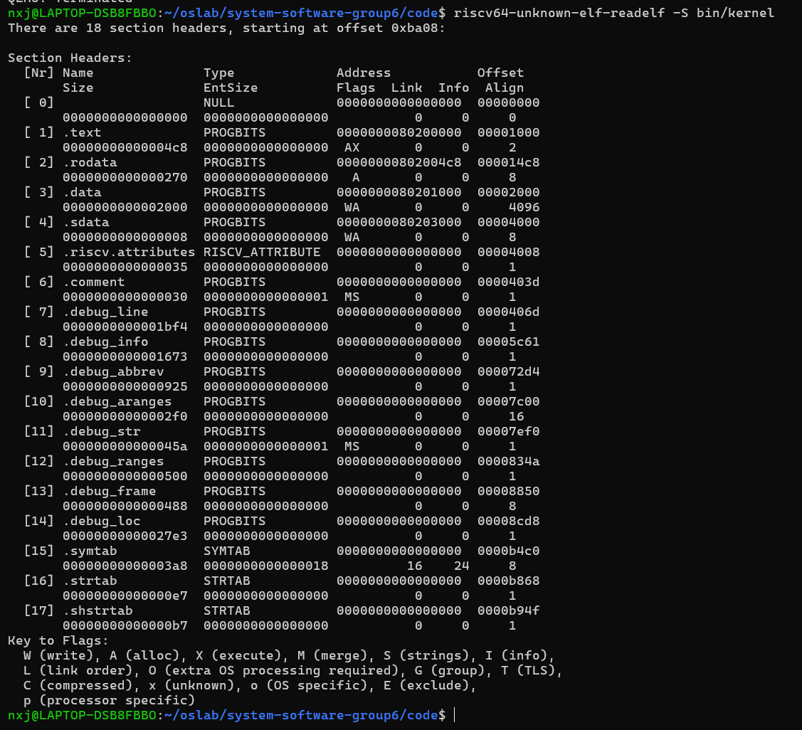
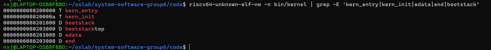
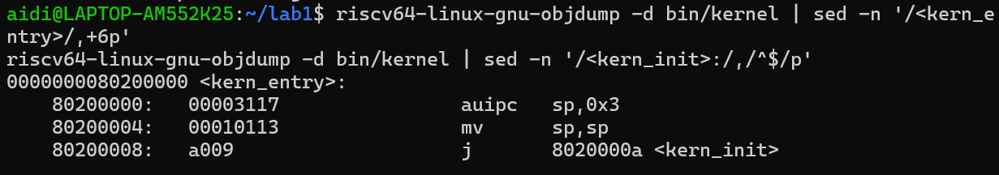
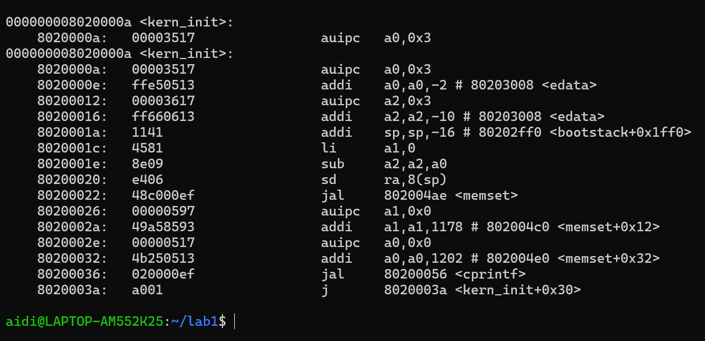
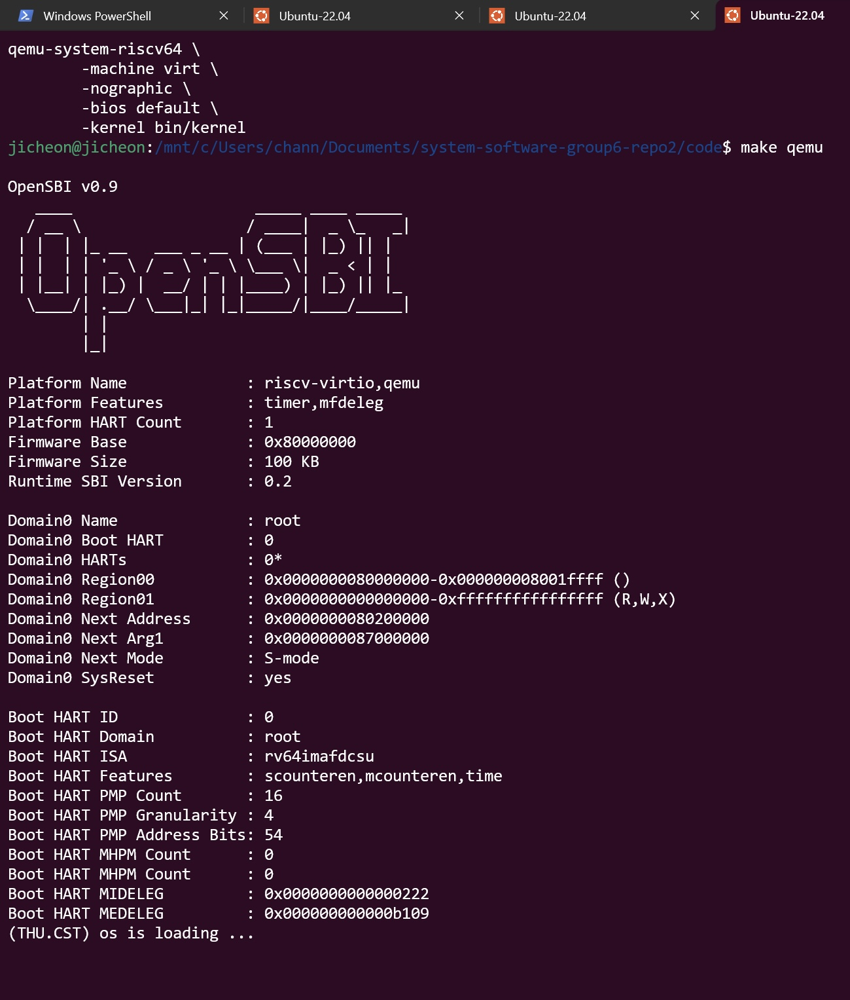
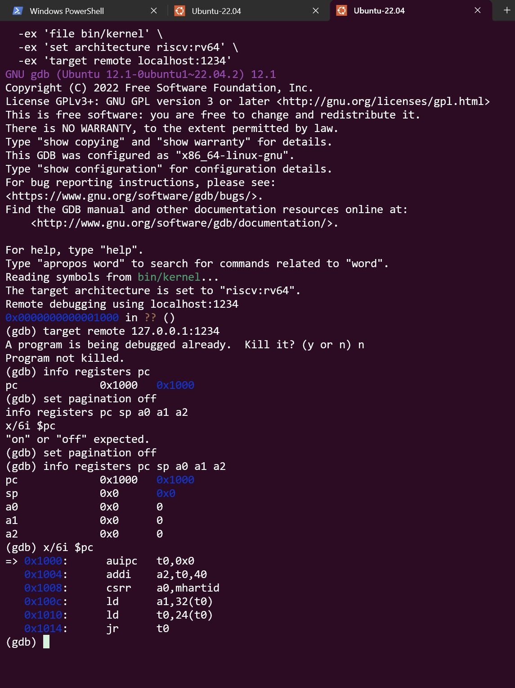
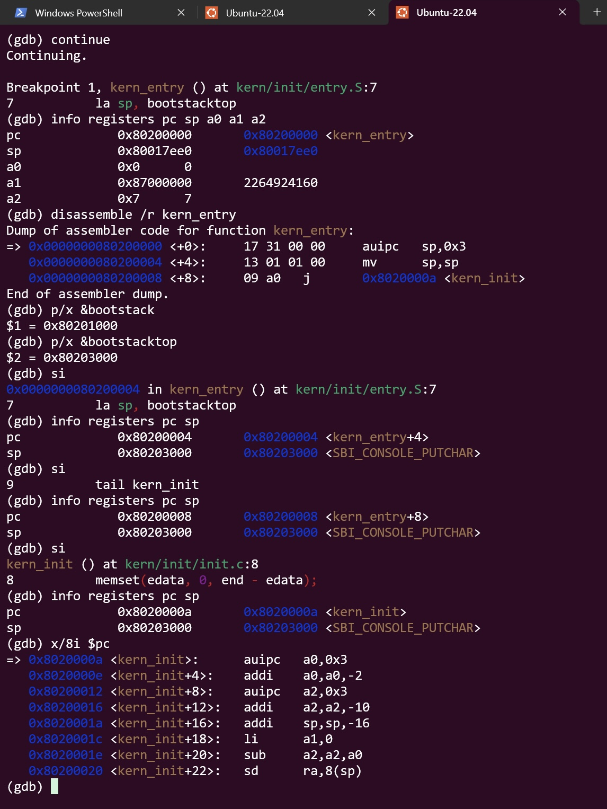

# Lab1：最小可执行内核实验报告

## 实验基本信息

| 项目 | 内容 |
|---|---|
| 实验名称 | Lab 1：比麻雀更小的麻雀（最小可执行内核） |
| 小组成员 | 【待填写：学号-姓名、学号-姓名、学号-姓名】 |
| 完成日期 | 2026-10-10 |

### 小组分工

| 成员 | 负责的练习/模块 |
|---|---|
| A【待填写姓名学号】 | Makefile、链接脚本、交叉编译和 GitHub 项目管理 |
| B【待填写姓名学号】 | 内核启动原理、核心代码和练习一 |
| C【待填写姓名学号】 | QEMU/GDB 调试、寄存器与指令分析和练习二 |

实验报告由三名成员分别完成本人负责部分，A 负责最终合并，三人共同检查。

## 一、实验目的

1. 熟悉 RISC-V 64 位操作系统内核的编译、链接与启动过程。
2. 掌握 RISC-V 交叉编译工具链、QEMU 模拟器及 GDB 调试工具的基本使用方法。
3. 理解 Makefile 的构建规则，以及链接脚本对内核内存布局的控制。
4. 通过实际运行和 ELF 文件分析，验证内核入口地址、程序节布局及启动栈的分配情况。

## 二、实验环境

| 项目 | 实验环境 |
|---|---|
| 宿主系统 | Windows + WSL Ubuntu |
| 目标架构 | RISC-V 64 位 |
| 交叉编译工具链 | SiFive RISC-V GNU Toolchain 10.2.0 |
| 模拟器 | QEMU（RISC-V virt 平台） |
| 固件 | A：OpenSBI v1.3；C：OpenSBI v0.9 |
| 调试工具 | A：riscv64-unknown-elf-gdb；C：gdb-multiarch 12.1 |
| 版本管理 | Git + GitHub |

本组使用的 AI 工具如下：

| 成员 | AI 编程工具 | 底层模型 | 备注 |
|---|---|---|---|
| A【待填写姓名学号】 | ChatGPT | 【由 A 补充】 | 编译链接与项目管理 |
| B【待填写姓名学号】 | Codex 桌面应用 | deepseek-V4-pro | 内核启动原理与练习一 |
| C【待填写姓名学号】 | Codex 桌面应用 | GPT-5 | GDB 调试与练习二 |

## 三、实验原理

### 3.1 RISC-V 内核启动流程

本实验使用 QEMU 模拟 RISC-V 64 位计算机，主要启动流程如下：

CPU 加电复位 → 执行复位地址 `0x1000` 处的引导代码 → 进入 OpenSBI 固件 → 跳转至 `0x80200000` → 执行 `kern_entry` → 初始化内核栈 → 进入 `kern_init()`。

整个过程是「固件 → 引导程序 → 操作系统」的三级接力。CPU 加电后，PC 被硬件置为复位地址 `0x1000`，这里执行的是一小段固化在只读存储器中的跳板代码，它准备好 hart ID、设备树地址等参数后跳转到固件。操作系统内核无法把自己加载进内存，必须由更底层的程序先运行并完成这一步交接。

OpenSBI 固件位于 `0x80000000`，运行在最高特权级 M 模式。它完成处理器与平台的初始化，并对外提供 SBI 服务（如控制台输出、定时器）；初始化完成后，OpenSBI 把控制权交给运行在 S 模式的内核，交接地址就是内核入口 `0x80200000`。

内核入口汇编代码 `kern_entry` 负责完成进入 C 语言环境前的必要准备：把栈指针设置到内核栈顶，再跳转到 C 入口 `kern_init()`。内核之所以固定在 `0x80200000`，是因为内核属于地址相关代码，链接脚本已将入口地址写死为该值，QEMU 的加载地址与 OpenSBI 的跳转地址都必须与之保持一致。各阶段的指令与寄存器级验证见 5.1、5.2 节。

### 3.2 Makefile 编译构建流程

本实验使用 Makefile 管理内核的自动构建过程。执行 `make` 后，主要经历以下阶段：

**（1）交叉编译**

使用 `riscv64-unknown-elf-gcc` 编译 C 语言和汇编源文件，生成 RISC-V 目标文件。

由于宿主计算机使用 x86-64 架构，而目标程序需要在 RISC-V 64 位模拟环境中运行，因此必须使用交叉编译工具链。

Makefile 通过 `GCCPREFIX` 变量定义编译器前缀，并通过 `tools/function.mk` 中的辅助函数组织多个源文件的编译。

**（2）链接**

使用 `riscv64-unknown-elf-ld` 将目标文件链接为 `bin/kernel`。

关键链接命令包含：

```bash
$(LD) $(LDFLAGS) -T tools/kernel.ld -o $@ $(KOBJS)
```

其中，`-T tools/kernel.ld` 指定链接脚本，控制内核程序节的布局及入口地址。

**（3）生成内核镜像**

使用：

```bash
riscv64-unknown-elf-objcopy bin/kernel --strip-all -O binary bin/ucore.img
```

将 ELF 格式的内核转换为原始二进制镜像。

其中，`bin/kernel` 保存 ELF 结构和调试相关信息，`bin/ucore.img` 则用于原始二进制加载方式。

### 3.3 kernel.ld 链接与内存布局

链接脚本 `tools/kernel.ld` 中的重要定义如下：

```ld
OUTPUT_ARCH(riscv)
ENTRY(kern_entry)
BASE_ADDRESS = 0x80200000;
```

`OUTPUT_ARCH` 指定目标架构，`ENTRY` 指定内核入口符号，`BASE_ADDRESS` 设置内核基地址。

链接脚本按照 `.text`、`.rodata`、`.data`、`.sdata` 和 `.bss` 的顺序组织程序内容，并使用 `ALIGN(0x1000)` 将数据区对齐到 4 KiB 边界。

在本实验的 QEMU 环境中，OpenSBI 固件位于 `0x80000000` 一带，内核选择从 `0x80200000` 开始，以满足课程使用的固件和内核布局约定。

## 四、实验过程与结果

### 4.1 内核编译

在 `code/` 目录下执行：

```bash
make
```

编译过程依次处理 `entry.S`、`init.c`、`stdio.c`、`console.c` 等源文件，并链接生成内核。

编译完成后，得到：

| 文件 | 大小 | 类型 |
|---|---|---|
| `bin/kernel` | 约 48 KB | ELF 可执行内核 |
| `bin/ucore.img` | 约 13 KB | 原始二进制内核镜像 |

编译过程中未出现错误，说明交叉编译工具链和基本构建规则能够正常工作。

### 4.2 内核启动及问题排查

最初执行 `make qemu` 时，OpenSBI v1.3 正常启动，但输出中显示：

```text
Domain0 Next Address : 0x0000000000000000
```

且没有出现内核预期的打印信息。

检查 Makefile 后发现，原有 QEMU 启动命令使用：

```bash
-device loader,file=bin/ucore.img,addr=0x80200000
```

该参数指定了镜像的加载位置，但当前环境未能通过此方式正确设置固件移交控制权时的内核入口。

随后尝试：

```bash
qemu-system-riscv64 \
    -machine virt \
    -nographic \
    -bios default \
    -kernel bin/kernel
```

本次启动成功，OpenSBI 显示：

```text
Domain0 Next Address : 0x0000000080200000
Domain0 Next Mode    : S-mode
```

内核输出：

```text
(THU.CST) os is loading ...
```

因此，对 Makefile 的 `qemu` 和 `debug` 目标进行了相应调整，并重新验证运行和 GDB 连接功能。

这次排查表明：编译成功、链接成功与内核真正开始执行是不同阶段，需要分别验证。



### 4.3 ELF 节布局验证

使用以下命令查看 ELF 节头表：

```bash
riscv64-unknown-elf-readelf -S bin/kernel
```

实验结果显示，内核 ELF 文件包含 18 个节头表项。主要节的信息如下：

| 节名称 | 起始地址 | 大小 |
|---|---|---|
| `.text` | `0x80200000` | `0x4c8` |
| `.rodata` | `0x802004c8` | `0x270` |
| `.data` | `0x80201000` | `0x2000` |
| `.sdata` | `0x80203000` | `0x8` |

`.text` 节从 `0x80200000` 开始，与链接脚本的内核基地址一致。

`.rodata` 节结束地址为：

`0x802004c8 + 0x270 = 0x80200738`

由于链接脚本使用 `ALIGN(0x1000)`，后续 `.data` 节从 `0x80201000` 开始，验证了数据区的对齐规则。

此外，ELF 文件中包含 `.debug_info`、`.debug_line` 等调试信息节，为 GDB 调试提供支持。



### 4.4 内核符号地址验证

使用以下命令查看关键符号：

```bash
riscv64-unknown-elf-nm -n bin/kernel | grep -E 'kern_entry|kern_init|edata|end|bootstack'
```

得到：

| 符号 | 地址 |
|---|---|
| `kern_entry` | `0x80200000` |
| `kern_init` | `0x8020000a` |
| `bootstack` | `0x80201000` |
| `bootstacktop` | `0x80203000` |
| `edata` | `0x80203008` |
| `end` | `0x80203008` |

其中，`kern_entry` 与链接脚本指定的内核入口一致，`kern_init` 紧随入口汇编代码之后。

启动栈大小为：

`0x80203000 - 0x80201000 = 0x2000 = 8192 B`

即 8 KiB。

由于 RISC-V 栈向低地址增长，启动时将 SP 初始化为 `bootstacktop`，使后续函数能够正常使用栈空间。

此外，`edata` 与 `end` 地址相同，说明当前构建产物中两者之间没有需要额外清零的 BSS 空间。



## 五、实验练习

### 5.1 练习一：理解内核入口操作

**负责人：** B【待填写姓名学号】

**题目：** 阅读 `kern/init/entry.S` 内容代码，结合操作系统内核启动流程，说明指令 `la sp, bootstacktop` 完成了什么操作，目的是什么？`tail kern_init` 完成了什么操作，目的是什么？

本练习通过阅读内核入口汇编 `kern/init/entry.S` 与 C 入口 `kern/init/init.c`，结合编译链接得到的实际反汇编，分析内核在进入 C 语言环境之前做了哪些准备。各条结论均与 ELF 符号表及 `objdump` 反汇编相互印证。

#### 5.1.1 源码与符号地址

```asm
#include <mmu.h>
#include <memlayout.h>

    .section .text,"ax",%progbits
    .globl kern_entry
kern_entry:
    la sp, bootstacktop

    tail kern_init

.section .data
    # .align 2^12
    .align PGSHIFT
    .global bootstack
bootstack:
    .space KSTACKSIZE
    .global bootstacktop
bootstacktop:
```

`entry.S` 是内核的汇编入口，也是 OpenSBI 移交控制权后执行的第一段内核代码。它分为两部分：`.text` 段中定义全局符号 `kern_entry`（链接脚本中的 `ENTRY(kern_entry)` 指向它），负责建立内核栈并跳转到 C 入口；`.data` 段中用 `.space KSTACKSIZE` 预留内核栈空间。

栈大小由 `KSTACKSIZE = KSTACKPAGE * PGSIZE = 2 * 4096 = 8192` 字节（8 KiB）决定，定义在 `kern/mm/memlayout.h` 与 `kern/mm/mmu.h` 中。相关符号的实际链接地址如下：

| 符号 | 地址 |
|---|---|
| `kern_entry` | `0x80200000` |
| `kern_init` | `0x8020000a` |
| `bootstack` | `0x80201000` |
| `bootstacktop` | `0x80203000` |

`bootstacktop - bootstack = 0x80203000 - 0x80201000 = 0x2000 = 8192` 字节，与 `KSTACKSIZE` 一致。

#### 5.1.2 分析 `la sp, bootstacktop`

`sp` 是 RISC-V 的栈指针寄存器（x2），指向当前栈顶；`bootstacktop` 是 `.data` 段中定义的符号，表示内核栈的栈顶。`la` 是汇编的伪指令，`la sp, bootstacktop` 的作用是把 `bootstacktop` 的地址装入 `sp`。

**完成的操作**：把内核栈栈顶地址 `0x80203000` 设置到栈指针 `sp`。

**目的**：内核需要独立的栈。OpenSBI 跳入内核时，`sp` 仍指向固件阶段使用的栈，内核不能继续使用；栈从高地址向低地址增长，初始时栈为空，因此把 `sp` 指向栈顶。这样后续调用 C 函数时，返回地址和局部变量才有栈空间可保存，即为进入 C 语言运行环境做准备。

实测反汇编：

```asm
0x80200000 <+0>: auipc sp,0x3     # sp = 0x80200000 + 0x3000 = 0x80203000
0x80200004 <+4>: mv    sp,sp      # 低位偏移为 0
```

`la` 被展开为 `auipc` 与 `mv` 两条指令，与源码语义一致。



#### 5.1.3 分析 `tail kern_init`

`kern_init` 是 `kern/init/init.c` 中用 C 语言编写的内核入口，声明为 `__attribute__((noreturn))`，因为它最后进入死循环、不会返回。`tail` 表示尾调用，直接跳转到目标函数且不保存返回地址。

**完成的操作**：跳转到 C 函数 `kern_init`（地址 `0x8020000a`），把控制权交给 C 代码，并且不再返回。

**目的**：汇编只完成最低限度的环境准备（建立内核栈），实际的内核初始化（清空 `.bss`、打印信息）用 C 语言实现更清晰。由于 `kern_init` 不会返回，使用 `tail` 无需保存返回地址；这与普通 `call` 不同，后者会把返回地址写入 `ra`，用于函数返回后继续执行，而此处不需要。

实测反汇编：

```asm
0x80200008 <+8>: j 0x8020000a <kern_init>
```

#### 5.1.4 分析 `kern_init()` 的主要功能

`kern_init()` 位于 `kern/init/init.c`，是内核启动后真正开始执行初始化工作的 C 函数，主要包含三步：

1. **清空 `.bss` 段**：`memset(edata, 0, end - edata);`。其中 `edata` 和 `end` 是链接脚本用 `PROVIDE()` 定义的符号，分别表示数据段结束和 BSS 段结束；`.bss` 段存放初始化为 0 的全局变量，需要在启动时清零。由于内核不依赖标准库，`memset` 由 `libs/string.c` 自行实现。
2. **格式化输出**：`cprintf("%s\n\n", message);`，打印 `(THU.CST) os is loading ...`。`cprintf` 是内核自行实现的格式化输出函数，底层通过 SBI 调用（`ecall` 指令）请求 OpenSBI 输出字符。
3. **进入死循环**：`while (1);`。最小内核没有其他任务可执行，因此停留在此，这也是该函数被声明为 `noreturn` 的原因。

实测反汇编（关键部分）：

```asm
0x8020000a: auipc a0,0x3 / addi a0,a0,-2   # a0 = edata = 0x80203008
0x80200012: auipc a2,0x3 / addi a2,a2,-10  # a2 = end   = 0x80203008
0x8020001e: sub   a2,a2,a0                 # 长度 = end - edata
0x80200022: jal   802004ae <memset>        # 调用 memset
0x80200036: jal   80200056 <cprintf>       # 调用 cprintf
0x8020003a: j     8020003a                 # while(1)：跳转到自身
```

在本构建产物中 `edata` 与 `end` 地址相同（均为 `0x80203008`），说明当前没有需要额外清零的 BSS 空间。



#### 5.1.5 练习一结论

`entry.S` 的三条指令完成了内核进入 C 语言环境所需的最小准备：`la sp, bootstacktop` 把栈指针从固件阶段的旧栈切换到内核栈顶 `0x80203000`，`tail kern_init` 以不保存返回地址的跳转进入 C 入口 `0x8020000a`。进入 `kern_init()` 后，内核依次清空 `.bss`、打印启动信息并进入死循环。

由此可以归纳出内核入口的两个要点：一是必须在内核中重新建立自己的栈，不能沿用固件留下的栈；二是汇编入口只负责最低限度的环境准备，真正的初始化逻辑交给 C 代码完成。上述结论已在编译产物的反汇编中得到静态验证，寄存器级别的动态验证见 5.2 节。


### 5.2 练习二：使用 GDB 验证启动流程

**负责人：** C【待填写姓名学号】

本练习使用 QEMU GDB Stub 和 `gdb-multiarch`，观察 CPU 从复位地址 `0x1000` 出发，经 OpenSBI 初始化后进入 `0x80200000 <kern_entry>`，并验证内核启动栈的建立以及进入 `kern_init` 的过程。

调试前，C 组员已完成 `make` 和 `make qemu`，确认内核能够正常输出启动信息。



#### 5.2.1 调试准备与问题排查

在第一个 Ubuntu 终端进入 `code/` 目录并执行：

```bash
make debug
```

在第二个 Ubuntu 终端执行：

```bash
gdb-multiarch \
    -ex 'file bin/kernel' \
    -ex 'set architecture riscv:rv64' \
    -ex 'target remote localhost:1234'
```

首次连接时出现 `Connection timed out`。检查 Makefile 后发现，`debug` 目标中 `-kernel` 行末缺少续行反斜杠，导致 `-s -S` 没有作为 QEMU 参数执行。补齐反斜杠后，`-s` 在 1234 端口开启 GDB Stub，`-S` 使虚拟 CPU 在执行第一条指令前暂停。

由于当前 Ubuntu 环境使用 `gdb-multiarch`，Makefile 的 `gdb` 目标使用 `$(GDB)` 变量，可以通过以下命令调用：

```bash
make gdb GDB=gdb-multiarch
```

A 和 C 都只修改了 `code/Makefile`：A 将内核加载方式改为 `-kernel $(kernel)`；C 补齐调试命令的续行并适配 `gdb-multiarch`。`kern/`、`libs/` 和 `tools/kernel.ld` 中的内核逻辑没有修改。

#### 5.2.2 观察复位地址 `0x1000`

连接成功后执行：

```gdb
set pagination off
info registers pc sp a0 a1 a2
x/6i $pc
```

实测初始寄存器为：

```text
pc = 0x1000
sp = 0x0
a0 = 0x0
a1 = 0x0
a2 = 0x0
```

从 `0x1000` 开始的六条指令为：

```asm
0x1000: auipc t0,0x0
0x1004: addi  a2,t0,40
0x1008: csrr  a0,mhartid
0x100c: ld    a1,32(t0)
0x1010: ld    t0,24(t0)
0x1014: jr    t0
```

其中，`auipc` 取得 PC 相对基址；`addi` 令 `a2` 指向固件所需的动态信息；`csrr` 将当前 hart ID 放入 `a0`；第一条 `ld` 取得设备树地址并放入 `a1`；第二条 `ld` 取得 OpenSBI 入口；`jr t0` 跳转到 OpenSBI。由此可知，`0x1000` 处执行的是 QEMU 提供的复位跳板，而不是 uCore 内核本身。



#### 5.2.3 观察内核入口 `0x80200000`

设置断点并继续运行：

```gdb
break *0x80200000
continue
info registers pc sp a0 a1 a2
disassemble /r kern_entry
p/x &bootstack
p/x &bootstacktop
```

断点命中时得到：

```text
pc = 0x80200000 <kern_entry>
sp = 0x80017ee0
a0 = 0x0
a1 = 0x87000000
a2 = 0x7
```

`a0 = 0` 表示启动 hart 的编号为 0，`a1 = 0x87000000` 是 OpenSBI 传给下一阶段的设备树地址。此时 `sp` 仍是固件阶段使用的栈。

`kern_entry` 的实际反汇编为：

```asm
0x80200000 <+0>: auipc sp,0x3
0x80200004 <+4>: mv    sp,sp
0x80200008 <+8>: j     0x8020000a <kern_init>
```

符号地址为：

```text
bootstack    = 0x80201000
bootstacktop = 0x80203000
```

逐条执行后的变化如下：

| 状态 | PC | SP | 说明 |
|---|---|---|---|
| 命中 `kern_entry` | `0x80200000` | `0x80017ee0` | 仍使用 OpenSBI 的旧栈 |
| 执行第一条入口指令后 | `0x80200004` | `0x80203000` | SP 切换到 `bootstacktop` |
| 执行第二条入口指令后 | `0x80200008` | `0x80203000` | SP 保持不变 |
| 执行跳转后 | `0x8020000a` | `0x80203000` | 进入 `kern_init` |

GDB 将 `0x80203000` 同时显示为相邻全局符号名 `<SBI_CONSOLE_PUTCHAR>`，但 `p/x &bootstacktop` 和 SP 的数值均为 `0x80203000`，因此可以确认启动栈设置成功。



#### 5.2.4 练习二结论

RISC-V 虚拟机启动后首先从物理地址 `0x1000` 执行 QEMU 复位跳板。最初六条指令准备 hart ID、设备树地址和固件相关参数，并跳转到 OpenSBI。OpenSBI 在机器态完成平台和处理器初始化后，以 S 模式把控制权交给 `0x80200000` 的 `kern_entry`。

在内核入口处，`la sp, bootstacktop` 被展开为实际机器指令，实测使 SP 从固件栈 `0x80017ee0` 变为内核栈顶 `0x80203000`。随后 `tail kern_init` 被链接为不保存返回地址的跳转，PC 进入 `0x8020000a <kern_init>`。以上结果动态验证了“复位跳板 → OpenSBI → 内核入口 → 建立内核栈 → C 入口”的完整启动过程。

本练习使用 AI 的具体提示词、连接超时问题和迭代过程记录在 `prompt.md` 中，所有寄存器值和反汇编均来自实际 GDB 输出。

## 六、实验总结

### 6.1 主要知识点

本实验涉及交叉编译、ELF 文件结构、链接脚本、内核入口、启动栈以及固件与操作系统之间的控制权交接。

通过实际编译和启动，理解了 Makefile 负责组织构建流程、链接脚本负责确定地址布局、QEMU 与 OpenSBI 配合完成内核启动的基本关系。GDB 调试进一步验证了 CPU 从复位地址进入固件、再由固件进入内核的动态过程。

### 6.2 与操作系统理论知识的联系

交叉编译和链接属于操作系统构建的基础环节，内核启动体现了计算机从底层固件进入操作系统的过程。

本实验还初步涉及栈空间、特权模式和内存布局等概念，为后续进程管理、虚拟内存与中断处理实验奠定基础。

### 6.3 本实验尚未涉及的知识

当前内核仅实现最基础的启动及输出功能，尚未完整实现物理内存分配、虚拟内存管理、进程调度、并发同步和文件系统等操作系统核心机制。这些功能将在后续实验中逐步学习和实现。

### 6.4 实验心得

通过本次实验，认识到操作系统内核开发不仅需要正确编写源代码，还需要保证编译工具链、链接地址、启动固件和模拟器配置之间相互匹配。

特别是在排查内核无法正常启动和 GDB 连接超时的问题时，通过对比 ELF 入口地址、QEMU 启动参数、OpenSBI 输出和 Makefile 命令，逐步确定了问题所在，进一步理解了内核从构建到执行的全过程。

### 6.5 AI 协作开发的经验

本实验中，AI 主要用于提供环境配置建议、解释源码与指令、协助定位构建和调试问题，以及整理实验记录。较有效的协作方式是先实际执行命令，再把完整输出和截图交给 AI 分析，随后按建议进行最小修改并重新验证。AI 给出的结论不能替代实验结果，最终仍需由源码、寄存器值、命令输出和截图共同证明。
