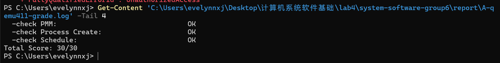
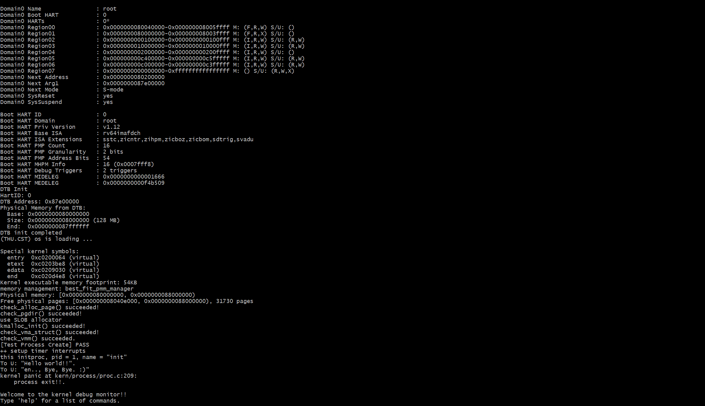

# 实验报告

## 实验基本信息

| 项目 | 内容 |
|---|---|
| **实验名称** | Lab 4：进程管理 |
| **小组成员** | 2513613-李佳凝、2512558-张爱迪、2513582-张子芊 |
| **完成日期** | 2026-11-12 |

### 小组分工

| 成员 | 负责的练习/模块 |
|---|---|
| 2513613-李佳凝 | 功能模块一：虚拟内存页操作；Challenge 2；最终完整评分 |
| 2512558-张爱迪 | 功能模块二：进程创建及初始化；功能模块三中的 `cpu_idle()`、`proc_run()` |
| 2513582-张子芊 | 迁移 Lab3 Trap 代码；功能模块三中的 `schedule()`、`switch_to()`；Challenge 1 |

实验报告由三人边实现边填写本人负责部分。当前文件已填写 C 的实际工作，A、B 在同一文件中继续补充各自模块。

---

## 一、实验目的

1. 理解内核线程从创建、登记到调度运行的完整过程。
2. 掌握进程控制块、Trap frame、上下文和内核栈之间的关系。
3. 实现轮转调度和 RISC-V 被调用者保存寄存器的上下文切换。
4. 理解通过保存和恢复 `sstatus.SIE` 保护内核临界区的机制。

---

## 二、实验环境

| 成员 | AI 编程工具 | 底层模型 | 备注 |
|---|---|---|---|
| 2513613-李佳凝 | Codex 桌面应用 | GPT-6 | Windows + WSL Ubuntu；riscv64-linux-gnu-gcc、QEMU |
| 2512558-张爱迪 | 待 B 填写 | 待 B 填写 | |
| 2513582-张子芊 | Codex 桌面应用 | GPT-5 | Windows 工作区；使用 WSL 中的 RISC-V GCC 与 QEMU 工具链做编译检查 |

---

## 三、实验整体逻辑分析

### 3.1 本章节的逻辑主线

内存管理先提供可靠的物理页和页映射；proc_init 建立 idleproc/initproc；cpu_idle 经 schedule、proc_run、switch_to 让线程执行。内核线程共享内核地址空间，页表机制为后续用户进程准备基础。

### 3.2 功能的逐步实现

先恢复 Lab2 物理内存初始化和 Best Fit 分配器，再实现映射增加、替换、撤销；使用 B/C 已提交的进程与调度代码进行整体编译和评分。

---

## 四、实验内容与实现

### 功能模块一：虚拟内存页操作

**负责人：** 2513613-李佳凝

#### Lab2 代码恢复

恢复 page_init：依据 DTB 获取内存范围，预留内核与 Page 数组，初始化可用页。恢复 best-fit 分配、分裂和相邻空闲块合并，导出框架需要的 default_pmm_manager。

#### `page_insert()`

page_insert 先取得叶 PTE，再增加新页引用；同页重映射抵消新增引用，不同页替换通过 page_remove_pte 撤销旧映射。随后写入页号和 perm|PTE_V 并刷新 TLB。

#### `page_remove()` 与 `page_remove_pte()`

page_remove 使用 create=0 查找，缺失时无副作用。page_remove_pte 清除有效 PTE、刷新 TLB、减少引用，归零时释放物理页；中间页表由上层管理。


#### Spec 和 Prompt

get_pte 增加失败回滚：若第二个中间页分配失败，只撤销本次新分配的上级页表，保留原有结构。Spec 与四段式提示词见 prompt.md 的 A 节。函数前提是有效页目录、合法已分配页以及调用者同步；不处理大页拆分。

#### 实现过程中的问题

实际排查：原 default_pmm.c 包含不存在的 best_fit_pmm.h，且管理器缺失；改用已有 default_pmm.h 并恢复 Best Fit 实现及导出符号。QEMU 版本导致的缺页定位和最终实测结果见第五章。

---

### 功能模块二：进程创建及初始化

**负责人：** 2512558-张爱迪

#### `alloc_proc()`

`alloc_proc()` 通过 `kmalloc()` 分配 PCB，并把所有字段置于安全初始状态：`state=PROC_UNINIT`、`pid=-1`、`runs=0`、`kstack=0`、`need_resched=0`，父进程、`mm`、`tf` 置空，`context` 清零，`pgdir` 指向内核页表根节点的物理地址 `boot_pgdir_pa`，`flags` 和 `name` 清零。它为后续资源分配提供一个不会误用未初始化字段的空白 PCB。

#### `proc_init()`

`proc_init()` 初始化 `proc_list` 与 `hash_list`，然后把当前启动执行现场包装成第 0 个内核线程 `idleproc`：设置 PID 0、`PROC_RUNNABLE`、内核栈为 `bootstack`、`need_resched=1`，令 `current` 指向它。随后通过 `kernel_thread(init_main, "Hello world!!", 0)` 创建第 1 个内核线程 `initproc`，登记为 PID 1，并命名 `init`。

#### `kernel_thread()`、`do_fork()` 与首次运行现场

`kernel_thread()` 在栈上构造临时 Trap frame，将线程入口放入 `gpr.s0`、参数放入 `gpr.s1`，再把返回地址设为 `kernel_thread_entry`；`status` 从当前 `sstatus` 派生，置 `SPP`、`SPIE` 并清 `SIE`。随后调用 `do_fork()`，把普通函数包装成可调度线程。

`do_fork()` 依次分配 PCB、内核栈，调用 `copy_mm()` 与 `copy_thread()`，在关中断临界区内分配 PID、把 PCB 挂入哈希表和进程链表并增加 `nr_process`，最后 `wakeup_proc()` 置为 `PROC_RUNNABLE` 并返回 PID。前三步任一失败都会回滚：PCB 分配失败直接返回；内核栈分配失败释放 PCB；`copy_mm()` 失败时同时释放内核栈和 PCB。

`copy_thread()` 把 Trap frame 放到新进程内核栈顶端，设置子线程返回值 `a0=0`、Trap frame 的 `sp`，并令 `context.ra=forkret`、`context.sp` 指向 Trap frame，使线程第一次被切换时经 `forkret -> forkrets -> __trapret -> kernel_thread_entry` 进入目标函数。

#### `copy_mm()`

本实验创建的是共享内核地址空间的内核线程，`current->mm` 为 `NULL`，因此 `copy_mm()` 只保持完整函数接口并返回 0，不复制用户地址空间；`proc->mm` 保持 `NULL`，为后续用户进程实验预留扩展点。

#### 实现过程中的问题

联调时最容易混淆的是 `idleproc` 与普通 fork 出来的线程：`idleproc` 直接复用启动现场和 `bootstack`，不需要再复制 Trap frame；`initproc` 才是第一个通过 `kernel_thread()->do_fork()` 创建的线程。另一个关键是 `pgdir` 必须保存页表根节点的物理地址 `boot_pgdir_pa`，否则 `proc_run()` 写入 `satp` 时无法正确切换地址空间。调试验证中还确认，`do_fork()` 的两级失败清理必须区分：内核栈失败只释放 PCB，`copy_mm()` 失败还要释放内核栈，否则会留下物理页泄漏。

---

### 功能模块三：进程调度与上下文切换

**负责人：** 2512558-张爱迪、2513582-张子芊

#### C 负责的函数

```c
void schedule(void);
void switch_to(struct context *from, struct context *to);
```

#### Lab3 Trap 代码迁移

C 将本组已经验证过的 Lab3 Trap 实现迁入 Lab4：

- 在 `kern/trap/trapentry.S` 中补全 `RESTORE_ALL` 和 `__alltraps`；
- 保留 Lab4 新增的 `forkrets`，没有整文件覆盖；
- 在 `kern/trap/trap.c` 中恢复 `interrupt_handler()` 和 `exception_handler()`；
- 保留原 Lab3 实现者学号，C 只负责迁移和兼容性核对。

`RESTORE_ALL` 先恢复 `sstatus` 和 `sepc`，再按 Trap frame 槽位恢复通用寄存器，最后恢复原始 `sp`。`__alltraps` 将当前 `sp` 作为 Trap frame 指针放入 `a0`，再调用 `trap()`。新内核线程第一次运行时，B 设置的 `context.ra = forkret` 会进入 `forkrets -> __trapret -> RESTORE_ALL -> sret` 恢复链。

#### `schedule()`

`schedule()` 在保存并关闭本地中断后清除 `current->need_resched`。当前进程是 `idleproc` 时从 `proc_list` 表头开始查找，否则从当前进程的后继开始查找。遍历允许越过表头继续，只选择 `PROC_RUNNABLE`；没有普通可运行进程时回退到 `idleproc`。

选中目标后增加 `next->runs`。当 `next != current` 时调用 B 实现的 `proc_run(next)`，最后按进入函数前保存的标志恢复中断状态。

#### `switch_to()`

`switch_to()` 使用 `a0` 指向旧 context、`a1` 指向新 context。它按照 `struct context` 的字段顺序保存旧进程的 `ra`、`sp`、`s0-s11`，再从新进程 context 的相同偏移恢复这些寄存器，最后执行 `ret` 跳转到恢复后的 `ra`。

汇编使用 `STORE`、`LOAD` 和 `REGBYTES` 表示寄存器宽度及偏移，没有硬编码 RV64 的 8 字节槽宽。

#### Spec 和 Prompt

C 的普通任务 Prompt 位于 `report/prompt.md` 的 C 章节：

1. 迁移已验证的 Lab3 Trap 实现；
2. 实现功能模块三的 `schedule()` 和 `switch_to()`。

两份 Prompt 均使用 `[PROMPT]`、`[RELY]`、`[GUARANTEE]`、`[SPECIFICATION]` 四段结构。第一份限制为迁移已验证代码并保留 `forkrets`；第二份明确进程链表规则、`runs` 计数、上下文字段顺序和寄存器偏移。

#### 实现过程中的问题

完整构建在 A 负责的 `kern/mm/default_pmm.c` 处因缺少 `best_fit_pmm.h` 停止。为验证 C 的实现，单独编译 `trap.c`、`trapentry.S`、`sched.c`、`switch.S` 及 B 的 `proc.c`，均成功生成目标文件。反汇编进一步确认 `switch_to` 按偏移 0 至 104 字节保存和恢复 14 个上下文字段并以 `ret` 返回。完整运行测试等待 A 的代码进入工程后进行。

#### B 负责的函数

```c
void cpu_idle(void);
void proc_run(struct proc_struct *proc);
```

`cpu_idle()` 是 idleproc 的执行主体，函数永不返回。它循环检查 `current->need_resched`：当该标志为 1 时调用 `schedule()`，由调度器选择下一个可运行线程；`proc_init()` 已把 idleproc 的 `need_resched` 置 1，因此第一次进入 `cpu_idle()` 就会让出 CPU 给 initproc。若没有调度请求，则继续循环等待。

`proc_run()` 只在目标 `proc != current` 时执行切换。它在保存并关闭本地中断后把 `current` 更新为目标线程，使用 Sv39 方式把 `proc->pgdir` 写入 `satp`，刷新 TLB，再调用 `switch_to(&prev->context, &proc->context)` 保存旧现场、恢复新现场；切换回来后恢复进入函数前的中断状态。`satp` 的写入必须使用 `SATP_MODE_SV39`，不能使用 `libs/riscv.h` 中面向 Sv32 的 `lsatp()`。

#### 实现过程中的问题

实现 `proc_run()` 时，`current`、页表和实际执行现场必须在同一个关中断临界区内保持一致，否则切换过程中发生中断会使三者错位。另一个容易误判的问题是 `switch_to()` 不会像普通函数那样立即返回到 `proc_run()`：只有在旧线程将来重新被调度时，原调用点之后的 `local_intr_restore()` 才会继续执行。首次切换若失败，不能只检查 `proc_run()`，还要核对 `copy_thread()` 设置的 `context.ra`、`context.sp` 以及 C 负责的 `switch_to()` 寄存器偏移是否一致。

---

### Challenge 1：`local_intr_save/restore` 如何开关中断

**负责人：** 2513582-张子芊

`local_intr_save(intr_flag)` 展开后调用 `__intr_save()`。该函数读取 `sstatus` 的 `SSTATUS_SIE` 位：如果进入临界区前 SIE 为 1，就调用 `intr_disable()` 清除 SIE，并返回 1；如果原先已经关中断，则不重复操作并返回 0。因此 `intr_flag` 保存的是进入临界区前的中断状态。

`local_intr_restore(intr_flag)` 调用 `__intr_restore()`。它只在 `intr_flag` 为 1 时调用 `intr_enable()` 重新置位 SIE；当 `intr_flag` 为 0 时保持关中断。其行为如下：

| 进入前 SIE | save 后 | `intr_flag` | restore 后 |
|---|---|---|---|
| 1 | SIE 清零 | 1 | SIE 恢复为 1 |
| 0 | 仍为 0 | 0 | 仍为 0 |

该语义能够支持嵌套临界区：外层关闭中断后，内层再次执行 save 时看到 SIE=0，因此内层得到 `intr_flag=0`；内层 restore 不会提前开启中断，最终由外层 restore 恢复原状态。

该机制只关闭当前 hart 的本地中断响应，防止当前 CPU 被中断处理程序打断；它不能阻止其他 hart 同时访问共享数据，因此不能替代多核自旋锁或其他跨 CPU 同步机制。

---

### Challenge 2（A：2513613）

**第一问：两段 get_pte 代码为何相似？**

Sv32 使用二级页表，虚拟地址为 10+10+12 位，每页表 1024 个 4 字节 PTE。Sv39 使用三级，每级索引 9 位，页内偏移 12 位，每表 512 个 8 字节 PTE。Sv48 使用四级，索引为 9+9+9+9 位，加 12 位偏移。Sv39/Sv48 的高位分别为位 38/47 的符号扩展。

本实验 get_pte 的两段代码分别沿 PDX1 和 PDX0 下降：检查有效位，按 create 决定是否分配，设置页引用，清零新表，再安装下级表地址。两段结构相同，因为不同层都使用同样的页表页结构；最后 PTX 定位叶项。硬件允许高层叶项表示大页，但此函数的路径假设中间层为目录，不能直接当作通用大页遍历器。

**第二问：是否拆分查找与分配？**

可以拆成只读 lookup_pte 与可分配 ensure_pte，并复用内部 walk。前者适合查询和删除，保证不分配；后者适合插入，明确错误与回滚责任。这样调用意图清晰，也便于失败注入测试。代价是接口和回滚状态更多，若复制遍历代码反而难以维护。本实验保留 get_pte(create) 接口以兼容调用者，create=0/1 区分行为，并补上新建中间页分配失败的回滚。

依据：[RISC-V Supervisor 规范](https://docs.riscv.org/reference/isa/priv/supervisor.html)。上述接口取舍为结合本实验源码的分析。


## 五、测试与验证

### A 的实际验证记录（更新于 2026-11-19）

实验指导《实验指导.docx》的“安装模拟器 Qemu”一节以 QEMU 4.1.1 为示例，并要求版本在 4.1.0 以上。起初在 WSL 自带 QEMU 8.2.2 上，按课程原框架设置非叶页表项 `PTE_U | PTE_V` 时，`check_pgdir()` 通过，但随后 `check_boot_pgdir()` 对低地址 `0x100` 的写入发生缺页。进一步按指导书下载、编译 QEMU 4.1.1 后，使用**同一份正式内核代码**运行，`check_alloc_page()`、`check_pgdir()`、`check_boot_pgdir()`、VMM 检查及 initproc 规定输出均出现。因此本次缺页与两版 QEMU 的页表遍历行为差异有关，不能据此判断三位同学的模块均失败。

在 QEMU 4.1.1 下，用裸机 RISC-V 工具链运行完整 `make grade`，实际结果：

```text
-check PMM:                                OK
-check Process Create:                     OK
-check Schedule:                           OK
Total Score: 30/30
```

评分在工作台的 `qemu411-grade-copy` 运行。该副本取自当前正式 `code/`；仅为 WSL 执行转换 `tools/grade.sh` 的 Windows 换行，并用启动包装脚本指定 QEMU 4.1.1 和内核镜像。课程测试断言和评分判断未修改。正式 `pmm.c` 中原框架的 `PTE_U` 设置与 `check_pgdir()` 断言保持一致。证据为 `A-qemu-4.1.1.log` 和 `A-qemu411-grade.log`。Windows 下的 QEMU 8.2.2 失败记录仅作为版本排查依据，不作为最终截图。

**最终评分截图。** 下图为 QEMU 4.1.1 环境下的实际 `make grade` 结果，包含三项 OK 和 `Total Score: 30/30`。



### B 的实际验证记录

`test_lab4_process_create()` 注入在 `proc_init()` 末尾执行，检查 idleproc/initproc 的创建结果：

- `current == idleproc`，`idleproc->pid == 0`，状态为 `PROC_RUNNABLE`；
- `idleproc->kstack == bootstack`，`parent/mm/tf` 符合第 0 个内核线程的初始状态；
- `initproc->pid == 1`，状态为 `PROC_RUNNABLE`，`parent == idleproc`；
- `initproc->context.ra` 与 `context.sp` 均非 0，说明首次运行现场已经建立。

在最终代码的评分流程中，Process Create 项实际输出：

```text
[Test Process Create] PASS
```

截图如下：



### C 的实际验证记录

| 验证项 | 实际结果 |
|---|---|
| `kern/trap/trap.c` 编译 | 通过 |
| `kern/trap/trapentry.S` 编译 | 通过 |
| `kern/schedule/sched.c` 单独编译 | 通过 |
| `kern/process/switch.S` 单独编译 | 通过 |
| B 的 `kern/process/proc.c` 接口编译 | 通过 |
| `switch.o` 反汇编偏移检查 | 通过，14 个字段与 `struct context` 一致 |
| `schedule`、Trap handler 符号检查 | 通过 |
| 完整 `make` | 在 A 的 `default_pmm.c` 处失败：缺少 `best_fit_pmm.h` |
| `make qemu` | 未执行，完整工程尚未构建成功 |
| `make grade` | 未执行，等待 A 的功能模块一 |

上述结果仅证明 C 的文件能够编译，不能替代 `[Test Schedule] PASS`。完整工程可编译后，还需运行调度测试和最终评分。

---

## 六、实验总结与收获

### 对操作系统的理解

C 负责部分体现了调度策略和上下文切换机制的分层：`schedule()` 决定“运行谁”，`proc_run()` 负责切换当前进程和地址空间，`switch_to()` 只负责“如何切换寄存器现场”。这种分层使调度策略与体系结构相关汇编相互独立。

Trap frame 与 context 的用途不同：Trap frame 保存异常或中断边界上的完整处理器状态；context 只保存函数调用约定要求被调用者保持的寄存器，用于内核线程之间的主动切换。减少保存范围可以降低上下文切换开销。

### AI 协作开发的经验

提示词中的 `[RELY]` 必须引用真实结构体布局、现有接口和测试条件；汇编任务尤其需要明确字段顺序与寄存器偏移。验证时应区分“单文件编译通过”“完整工程构建通过”和“运行测试通过”，不能用前一种证据替代后一种结论。

### B 的知识点与收获

通过实现模块二，理解了 PCB、内核栈、Trap frame 和 context 的分工：PCB 管理进程身份与生命周期，内核栈提供线程自己的运行空间，Trap frame 保存首次进入内核线程时的完整处理器状态，context 只保存主动切换时需要恢复的被调用者保存寄存器。idleproc 直接继承启动现场，而 initproc 通过 do_fork 创建，这让我更清楚“当前执行流”如何变成可调度线程。

模块三的 cpu_idle/proc_run 把“选择线程”和“切换线程”连接起来：cpu_idle 只在需要时让出 CPU，proc_run 负责 current、Sv39 页表和上下文三者的一致性，switch_to 则专注于寄存器现场保存与恢复。首次运行链 `forkret -> forkrets -> __trapret -> kernel_thread_entry` 也说明，进程创建和调度不是两个孤立模块，必须通过同一套 context/Trap frame 约定衔接。

与 OS 原理相比，本实验的内核线程共享内核地址空间，copy_mm 只是占位；尚未实现用户进程地址空间、写时复制、fork/exec/wait、按需分页和多种调度策略。do_exit 在本实验中也仍是 stub。验证方面，我认识到单文件编译通过、完整构建通过和运行测试通过是三个不同层次；Process Create 测试能直接覆盖 PCB 字段、内核栈和首次运行现场，但完整结论仍要等三位同学代码合并后由 make grade 给出。


### A 的知识点与收获

页表对应 OS 原理中的地址转换，引用计数支持同一物理页的多个映射，TLB 失效保证硬件翻译与软件修改一致。Best Fit 选择最小足够块，分裂和合并减少外部碎片，但查找需遍历空闲块。本实验以共享内核地址空间和预映射为主，尚不等于具备用户地址空间隔离、写时复制或完整页面置换系统。关闭本地中断也不等于多核互斥。AI 输出须结合宏、测试和实际日志核对，不能把预期 PASS 当成实测。
