# 实验报告

## 实验基本信息

| 项目 | 内容 |
|------|------|
| **实验名称** | Lab 2：物理内存与页表 |
| **小组成员** | 2513613-李佳凝、2512558-张爱迪、2513582-张子芊 |
| **完成日期** | 2026-10-23 |

### 小组分工

练习分工如下：

| 成员 | 负责的练习/模块 |
|------|----------------|
| 2513613-李佳凝（A） | 物理内存初始化 `page_init()`、硬件可用物理内存范围 Challenge、最终整合 |
| 2512558-张爱迪（B） | First-Fit 分析、Best-Fit 实现、Buddy System |
| 2513582-张子芊（C） | QEMU/GDB 页表查询调试、SLUB Challenge |

实验报告由三名成员分别完成本人负责的部分，A 负责最终合并与格式检查。当前版本已合并 A、B、C 的实现说明、Challenge、Prompt、测试结果和必要截图。

---

## 一、实验目的

本实验的主要目的是：

1. 理解物理内存探测、页描述符初始化以及物理页分配器之间的关系。
2. 掌握 First-Fit、Best-Fit 等连续物理页分配算法的基本思想和实现方式。
3. 理解 RISC-V Sv39 地址翻译、页表项权限、超级页以及 TLB 的作用。
4. 使用双 GDB 调试 QEMU 4.1.1，观察模拟硬件如何把 uCore 虚拟地址翻译为物理地址。
5. 在物理页分配器之上实现简化 SLUB，形成“页分配—小对象分配”的两层内存管理结构。
6. 按任务目标、功能边界和可验证结果设计 Prompt，并依据真实代码、输出和截图完成验证。

---

## 二、实验环境

### 2.1 基础环境

三名成员分别填写本人实际使用的实验环境；路径等任务上下文写入对应 Prompt，不在基础环境中重复堆列。

| 成员 | 操作系统与开发环境 | 编译、运行和调试工具 |
|------|--------------------|----------------------|
| 2513613-李佳凝（A） | Windows + WSL2 Ubuntu 24.04.4 | SiFive GCC-Metal 10.2.0 裸机工具链、QEMU 8.2.2、OpenSBI 1.3 |
| 2512558-张爱迪（B） | Windows 11 + MSYS2 UCRT64，RISC-V 64 位 uCore Lab2 | riscv64-unknown-elf-gcc 16.1.0、Binutils 2.47、QEMU 11.1.2（OpenSBI 1.8.1）、Make 4.4.1 |
| 2513582-张子芊（C） | Windows + WSL Ubuntu 22.04，RISC-V 64 位 uCore Lab2 | `riscv64-unknown-elf` 工具链、QEMU 4.1.1 调试构建、host GDB、`gdb-multiarch` |

### 2.2 AI 工具

| 成员 | AI 编程工具 | 底层模型 | 备注 |
|------|------------|---------|------|
| 2513613-李佳凝（A） | Codex 桌面应用 | GPT-6.1（gpt-6.1-sol） | 物理内存初始化核对、边界修复、测试和报告整合 |
| 2512558-张爱迪（B） | Codex 桌面应用 | DeepSeek-V4-pro | 物理内存分配的理解、实现和比较 |
| 2513582-张子芊（C） | Codex 桌面应用 | GPT-5 | 按四段式设计 Prompt，辅助源码定位、GDB 调试、SLUB 实现与报告整理 |

---

## 三、实验整体逻辑分析

### 3.1 本章节的逻辑主线

本章围绕“内核如何认识、管理并使用内存”展开。首先从设备树取得物理内存范围，排除 OpenSBI、内核和页描述符数组占用的区域；随后把剩余完整页面交给物理内存管理器，并实现连续物理页的分配与回收；本框架在进入 C 代码之前已由 `entry.S` 启用 Sv39 启动页表，物理页初始化本身在高虚拟地址下执行；最后可以继续在页级分配器之上构建 SLUB，为内核提供小对象分配能力。

### 3.2 功能的逐步实现

1. **物理内存初始化**：先确定可管理内存边界并建立 `Page` 描述符，否则后续页分配器没有可靠的资源视图。
2. **连续物理页分配**：在已经登记的空闲页上实现 First-Fit、Best-Fit 和 Buddy System，提供 `alloc_pages()`/`free_pages()` 基础能力。
3. **虚拟地址翻译验证**：页表启用后，通过 QEMU 源码和双 GDB 观察 TLB miss、Sv39 查表、权限检查和 TLB 填充。
4. **SLUB 小对象分配**：以物理页分配器为后端，把一个页面划分为多个对象，实现更细粒度的内核内存分配。
5. **统一测试与回归**：完成干净构建、内核运行、SLUB 自检和课程评分，确认各模块合并后仍保持正确。

---

## 四、实验内容与实现

### 功能模块一·任务一：物理内存探测与页描述符初始化

**负责人：** 2513613-李佳凝（A）

#### 模块功能与本次完成范围

以 `6cc74ad` 为基线核对已有 `static void page_init(void)`。该实现已包含在 B 提交及当前合并分支中，本次保留其正确逻辑，补充启动映射上界检查与 `//lab2 function1 2513613` 注释，不将既有实现描述成本次从零生成。保留 Best-Fit 选择、所有课程测试及 C 的 SLUB。

`kern_init()` 先运行 `dtb_init()`，再调用 `pmm_init()`。后者先初始化当前 PMM，再由 `page_init()` 建立页描述符及空闲区，最后运行分配器自检。`entry.S` 已在进入 C 之前启用 Sv39；`page_init()` 不负责开启分页。

#### 初始化步骤与 spec

1. 从 DTB 查询 RAM 起点与大小，固定 `va_pa_offset=PHYSICAL_MEMORY_OFFSET`，检查零值、加法溢出和当前框架支持的 DRAM 起点。
2. 根据 `entry.S` 的高地址根级叶子映射，限制物理范围不得超过 `[0x80000000,0xc0000000)`。超过该范围需要建立额外映射，本次选择明确终止，避免虚拟地址加偏移回绕。框架的 128 MiB 常量不替代 DTB 实际容量；已实测 256 MiB。
3. `maxpa=ROUNDDOWN(mem_base+mem_size,PGSIZE)`，`npage=PPN(maxpa)`。`npage` 是上界页号，不是 RAM 页数；RAM 描述符数为 `npage-nbase`。
4. `pages_pa=ROUNDUP(PADDR(end),PGSIZE)`，`pages=pages_pa+va_pa_offset`。先检查数组能放入 RAM，再初始化每项的引用计数、标志、property、链表，并标为保留。
5. `freemem=ROUNDUP(pages_pa+(npage-nbase)*sizeof(struct Page),PGSIZE)`；没有完整空闲页时终止，避免调用要求 `n>0` 的 `init_memmap()`。
6. 只登记 `[freemem,maxpa)`。当前 PMM 的 `init_memmap()` 清除这些页面的保留标志并建立空闲块，OpenSBI、内核、描述符及对齐空间继续保留。

前置条件是 DTB 与 PMM 初始化完成、RAM 符合当前单段布局；后置条件是全局状态正确、已用页保留、完整空闲页可分配。四段式 spec/prompt 记录在 `prompt.md`。

#### 地址与描述符的关系

| 对象 | 转换关系 |
|---|---|
| 内核虚拟地址 VA 与物理地址 PA | `VA=PA+va_pa_offset`，反向使用 `PADDR(VA)` |
| 物理页号 | `PPN(PA)=PA>>12`，低 12 位为页内偏移 |
| 描述符数组索引 | `PPN(PA)-nbase` |
| 物理地址到描述符 | `pa2page(PA)=&pages[PPN(PA)-nbase]`，调用者必须保证 PA 在 RAM 范围内 |
| 描述符到页基址 | `page2pa(p)=(p-pages+nbase)<<12`；不恢复原地址页内偏移 |

#### 本次 128 MiB 实测布局

以下为本次正常构建的输出，不是评分注入后镜像的固定地址。`sizeof(struct Page)=40`，`npage=0x88000`，`nbase=0x80000`，描述符数 `32768`，数组占 `0x140000` 字节。

| 物理区间（左闭右开） | 用途 |
|---|---|
| `[0x80000000,0x80200000)` | 框架保留的固件/启动区域，保守保留 2 MiB，不等于固件实际大小 |
| `[0x80200000,0x8020622c)` | 内核镜像、启动栈、页表及静态数据至 end |
| `[0x8020622c,0x80207000)` | 内核尾部对齐空间 |
| `[0x80207000,0x80347000)` | Page 描述符数组 |
| `[0x80347000,0x88000000)` | 初始空闲区，共 31929 页 |

`pages` 的虚拟地址为 `0xffffffffc0207000`。编译器、代码或测试注入变化会改变 end 和数组位置，应以对应日志为准。

#### 实际问题与修复

- **启动映射边界缺少检查**：既有实现按 DTB 全部容量登记，超过根级 1 GiB 直接映射后可能生成无效/回绕虚拟地址。本次在写描述符前增加检查。独立临时副本将 `get_memory_size()` 返回值注入为 1 GiB+4096，实际 QEMU RAM 仍为 128 MiB，实测出现预期 panic，未登记空闲页。该验证属于故障注入，不是实际大内存机器测试。
- **工具链环境不一致**：默认工具链未在 PATH，最初尝试 Linux 交叉编译器后，镜像停在 OpenSBI 输出后。反汇编显示启动前使用 GOT 中的高虚拟地址，定位为该构建与裸机启动方式不兼容；切换本机已有 SiFive 裸机工具链后启动正常，无需修改 B、C 代码。
- **评分脚本 CRLF**：Windows 检出产生 CRLF，WSL 执行报 `\r: not found` 和语法错误。仅将工作副本 `tools/grade.sh` 换行为 LF，未改变测试内容，之后评分 20/20。
- **时间戳警告**：WSL 访问 Windows 文件系统时构建出现小于一秒的 clock skew 警告。完整干净构建退出 0，后续运行和评分通过；保留原始日志，不把警告隐藏或写成零警告。

#### Challenge 1：OS 如何获得硬件可用物理内存范围

OS 可以在启动时接收固件或引导程序提供的内存布局，不必预先写死容量。需要区分“物理 RAM 存在于此处”和“此处当前可以交给分配器”：固件、内核、启动信息、保留区以及内存空洞都需要另行处理。

| 方法 | 适用环境与信息来源 | OS 的使用方式 |
|---|---|---|
| DTB | 本实验的 RISC-V/QEMU 启动流程 | 取得 DTB 地址，解析 memory 节点的 reg 地址/大小，再考虑保留信息。DTB 也可描述多段 RAM；本实验解析器只取首段，不能声称支持完整多段布局。[Devicetree 规范](https://devicetree-specification.readthedocs.io/en/stable/devicenodes.html) |
| BIOS E820 | 传统 x86 BIOS | 在适用启动阶段调用 INT 15h、E820h，逐项取得地址、长度及类型；正常 RAM 和保留范围区别处理。[ACPI 系统地址映射规范](https://uefi.org/specs/ACPI/6.5/15_System_Address_Map_Interfaces.html) |
| UEFI GetMemoryMap | UEFI 平台 | OS loader 查询带类型的内存描述符，获取最新 map key 配合 ExitBootServices，按类型和生命周期决定可回收页面，不能把所有描述符都当空闲页。[UEFI Boot Services](https://uefi.org/specs/UEFI/2.10/07_Services_Boot_Services.html) |
| 引导协议传递映射 | 例如 GRUB/Multiboot | 引导程序把收集到的地址、长度、类型列表交给内核；内核读取并排除自身和引导模块占用。[Multiboot 规范](https://www.gnu.org/software/grub/manual/multiboot/html_node/Boot-information-format.html) |

直接向未知物理地址试写不能可靠替代内存映射：未知地址可能是 MMIO、受保护区域或有副作用的设备寄存器，也可能破坏已有数据。该判断是基于地址空间可能包含设备与保留区的分析，本实验没有执行破坏性试写。

本实验实际验证的是 DTB 方案；E820、UEFI 和 Multiboot 属于资料分析，没有实现或动态验证。当前简化 dtb.c 不是通用 FDT 校验器，也未完整处理 reserved-memory、保留表或 DTB 自身占用的通用扣除；因此测试通过不能解释为适用于任意真实硬件。本次遵守课程单段内存框架，未扩大为通用硬件内存管理器。

---

### 功能模块二：物理内存分配（任务一、任务二、任务三）

**负责人：** 2512558-张爱迪（B）

> 本报告覆盖 First-Fit 理解、Best-Fit 实现与测试、Buddy System 实现与测试，以及三者的比较。

#### 任务一：First-Fit 原理、函数分析与改进空间

##### 1.1 基本原理

First-Fit（首次适配）是最直接的连续物理内存分配策略：系统维护一条**按页地址升序**的
空闲块链表，每个空闲块用其头页的 `property` 字段记录块内页数。分配 n 页时，从链表头
开始找**第一个** `property >= n` 的块；若该块大于 n 就切出 n 页、剩余部分作为新空闲块
插回原位。释放时把块按地址插回链表，并尝试与前后物理相邻的空闲块合并，以减少碎片。

##### 1.2 数据结构与状态约定

- `struct Page`：`ref`（引用计数）、`flags`（位 0 保留、位 1 空闲块头）、`property`
  （仅块头有效，等于块内页数）、`page_link`（链表节点）。
- `free_area_t`：`free_list`（链表头）+ `nr_free`（空闲页总数）。
- 不变量：链表按地址升序；只有空闲块头页 `property != 0` 且带 `PG_property`；所有块头
  `property` 之和等于 `nr_free`。

##### 1.3 六个核心函数

- `default_init`：`list_init` 空链表、`nr_free = 0`。
- `default_init_memmap(base, n)`：逐页清 `flags`/`property`/`ref`，`base` 成为块头
  （`property = n`、置 `PG_property`），按地址插入链表，`nr_free += n`。
- `default_alloc_pages(n)`：`n > nr_free` 返回 NULL；否则从链头找第一个
  `property >= n` 的块；`property > n` 时在 `base + n` 处分裂出剩余块；`nr_free -= n`。
- `default_free_pages(base, n)`：逐页复位，`base` 成新块头按地址插入，用
  `p + p->property == base`（前相邻）与 `base + base->property == p`（后相邻）判断并合并，
  `nr_free += n`。
- `default_nr_free_pages`：返回 `nr_free`。
- `default_check`：自检链表不变量，并经 `basic_check` 与一组分配/释放/分裂/合并场景验证。

##### 1.4 改进空间

- 查找是 O(空闲块数) 的线性扫描；可按大小分桶加速，但会改变数据结构（接近 Buddy 思路）。
- 分裂没有“最小剩余块”阈值，可能留下 1~2 页的小碎块；可整块分配以减少外碎片。
- 释放需线性扫描定位插入点；用边界标记可 O(1) 合并，代价是每块多存元数据。
- 每次从头扫描导致低地址端反复被切小（前端碎片）；可用 next-fit 游标分摊。

结论：First-Fit 的实现简单、无内部碎片，但查找与碎片治理偏弱；其优化大多会改变算法
类别，本实验不要求，只需理解并在报告中说明。

#### 任务二：Best-Fit 的 spec、实现、测试与改进空间

##### 2.1 spec（实现要求）

Best-Fit 与 First-Fit 的区别只在选择策略：分配 n 页时，遍历整条空闲链表，选择
**`property >= n` 且 `property` 最小**的块；若多个块大小相同，选地址较小的（即链表中
先遇到的）。找到后：`property == n` 整块分配；`property > n` 在 `base + n` 处分裂出剩余
块并插回；清除被分配块头的 `PG_property`；`nr_free -= n`。其余 `init_memmap`、
`free_pages`（按地址插入 + 前后合并）、`nr_free_pages` 与 First-Fit 同构。

约束：保留 `basic_check()`、`best_fit_check()` 原样；提供 `free_area_t free_area` 与
`free_list`/`nr_free` 两个宏；注册 `best_fit_pmm_manager`（`name = "best_fit_pmm_manager"`，
`.check = best_fit_check`）；不能使用 malloc；必须通过 `-Werror`。

##### 2.2 实现

`kern/mm/best_fit_pmm.c` 提供 `best_fit_init`、`best_fit_init_memmap`、
`best_fit_alloc_pages`、`best_fit_free_pages`、`best_fit_nr_free_pages` 和
`best_fit_pmm_manager`。选择最小块的核心判断是：

```c
if (p->property >= n && (page == NULL || p->property < page->property))
    page = p;
```

因为链表按地址升序，用严格小于比较更新 `page`，相等大小时保留先遇到（地址更小）的块，
正好满足“最小且地址最小”的语义。分裂与合并复用 First-Fit 的链表操作。

##### 2.3 测试与运行结果

`make test` 会以 `-D ucore_test` 编译，触发 `best_fit_check()` 打印评分；其中
`assert(p0 + 4 == p1)` 专门验证“真的选了最小可用块而不是 First-Fit”。

**Best-Fit 启动**

执行 `make qemu`，实际输出包括：

```text
memory management: best_fit_pmm_manager
check_alloc_page() succeeded!
```

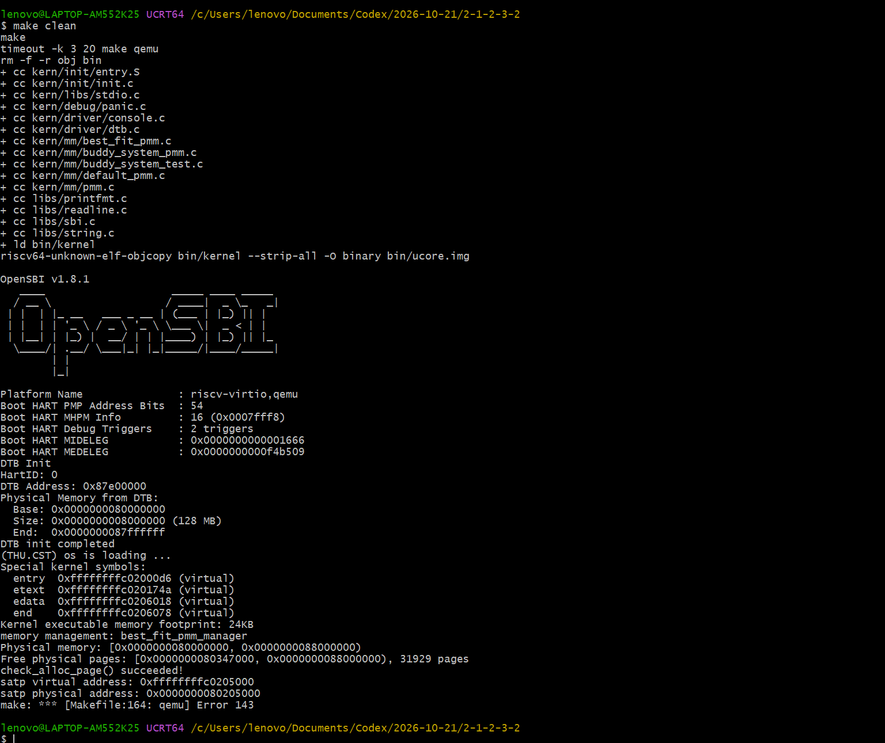

**Best-Fit 6 项评分**
先执行 `make clean`，再执行 `make test`，实际输出包括：

```text
memory management: best_fit_pmm_manager
grading: 1 / 6 points
...
grading: 6 / 6 points
check_alloc_page() succeeded!
```

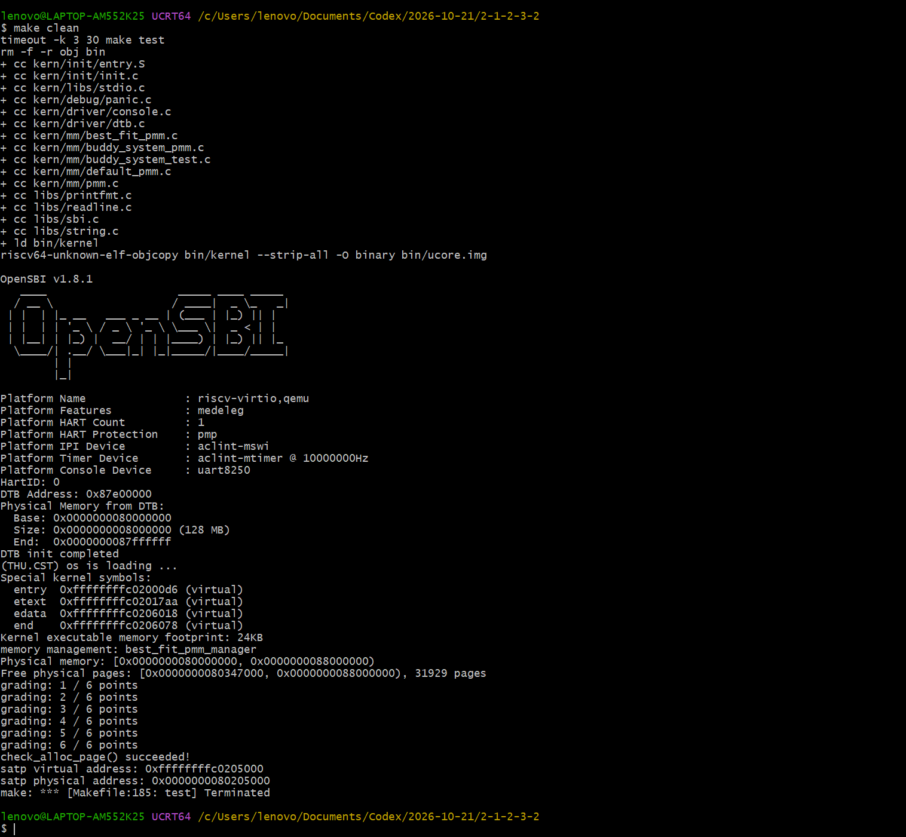

**Best-Fit 最终评分**
执行 `make grade GRADE_TMP=../.grade_tmp`，实际输出包括：

```text
check page init:     OK
check best fit:      OK
Total Score: 20/20
```

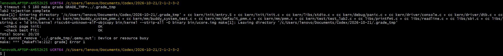

##### 2.4 改进空间

- 分配需遍历整条链表，O(空闲块数)，比 First-Fit 更慢（不能提前退出）。
- 同样没有“最小剩余块”阈值，可能产生小碎块。
- 释放仍需线性扫描定位插入点。
- 由于空闲链表按地址有序，“选最小”必然要多扫一遍；可配合按大小分桶来加速，但会改变
  数据结构类别（与 Buddy System 任务重叠）。

#### 任务三：Buddy System 测试覆盖及运行结果

##### 3.0 设计理念、方案与局限

**设计原理**：Buddy System 把空闲物理内存按 2 的幂分阶（阶 k 的块固定为 2^k 页），
每一阶维护一条独立的空闲链表。分配时把请求向上取整到 2 的幂，从足够大的阶一路对半
分裂到目标阶；释放时放回对应阶，并检查“伙伴”是否同阶且空闲，空闲则逐级向上合并。
核心就是“对半分裂、伙伴合并”，因此分配与释放都能做到 O(log N)，而不是 First-Fit /
Best-Fit 那样的线性扫描。

**方案要点**：用一个静态数组 `buddy_area[MAX_ORDER + 1]` 存每阶的空闲链表（不
malloc），块头页的 `property` 记录块大小 2^k、`PG_property` 标记空闲块头；伙伴地址用
物理页号异或 `ppn ^ (1 << k)` 计算，并要求阶 k 的块必须对齐到 2^k；初始化时用
“贪心取最大对齐幂”把任意大小的空闲区拆成若干对齐的 2 的幂块。

**设计边界与局限性**：

- 只能管理 2 的幂大小的块，分配时向上取整会带来**内部碎片**（最坏浪费近一半）。
- `MAX_ORDER` 是编译期常量（本实验取 20）；若物理内存超过 2^MAX_ORDER 页就会数组越界。
- 伙伴关系完全依赖“对齐”不变量：初始拆分或分裂一旦不对齐，异或算出的伙伴就会错位，
  这是实现里最容易出错的一处。
- 只做页级分配，不实现按对象大小的第二层分配（那是 SLUB 扩展任务的内容），也不做
  页级紧凑/搬移（会破坏页表映射）。
- 释放依赖调用方传入正确的块大小 n（必须是 2 的幂），因此用块头 `property` 留存块
  大小并做断言校验来降低误用风险。
- 相比 First-Fit / Best-Fit，对齐到 2^k 的约束使其外部碎片形态不同，某些负载下反而
  更碎；本实验没有采集真实性能数据，只做结构分析与复杂度比较。

##### 3.1 测试设计（七类行为测试）

`kern/mm/buddy_system_test.c` 的入口 `buddy_system_check()` 依次执行并做结构复核：

| 测试 | 覆盖场景 |
| --- | --- |
| `buddy_test_power_of_two` | 分配 1/2/4/8 页，校验地址对齐、`property` 与计数 |
| `buddy_test_large_block_split` | 先分大块再分小块，校验逐级分裂与不重叠 |
| `buddy_test_buddy_merge` | 伙伴空闲则合并、伙伴不空闲则不合并，按不同顺序释放 |
| `buddy_test_mixed_orders` | 交错分配/释放多种阶，校验不重叠、计数一致 |
| `buddy_test_exhaustion` | 逐页分配直到 NULL，校验不重复、计数归 0、逐块释放 |
| `buddy_test_unsatisfiable_request` | `alloc_pages(0)` 与超大请求返回 NULL 且不变 |
| `buddy_test_full_release_restore` | 全部释放后恢复初始空闲页数，并调用 `buddy_check()` |

**测试案例设计说明**：

- `buddy_test_power_of_two`：分配 1/2/4/8 页（本身都是 2 的幂、不触发向上取整），验证
  基本分配、地址对齐、`property` 正确和空闲计数按实际块大小减少。
- `buddy_test_large_block_split`：先分配 64 页大块再分配小块，验证向上取整与逐级分裂，
  以及分裂出的伙伴块被正确放回低阶链表后小块请求仍能得到满足且互不重叠。
- `buddy_test_buddy_merge`：这是最核心的一条——显式构造伙伴对并按不同顺序释放，验证
  “伙伴空闲才合并、伙伴不空闲不合并”，合并后形成一个更高阶块，直接检验伙伴关系。
- `buddy_test_mixed_orders`：交错分配/释放 1/4/8/32 页，验证不同阶的空闲块能共存、
  计数始终一致、不会重叠或丢失空闲页。
- `buddy_test_exhaustion`：逐页分配直到返回 NULL，用位图去重验证每次返回的页互不重复、
  计数最终归 0，并能逐块释放恢复，覆盖“耗尽”这一边界。
- `buddy_test_unsatisfiable_request`：验证 `alloc_pages(0)` 和超大请求返回 NULL 且空闲
  页数不变，覆盖“失败请求不得破坏状态”。
- `buddy_test_full_release_restore`：混合分配后全部释放，验证空闲页数恢复到测试前状态，
  并最后调用 `buddy_check()` 复核空闲链表结构，确认整个测试过程没有破坏初始状态。

每个测试都遵循“先记录初始空闲页数、结束前释放自己分配的页、断言恢复”，因此七类测试
彼此独立、不残留分配。

其中 `buddy_check()` 只验证**结构不变量**（链表结构、块对齐、阶数与 `property` 一致、
计数一致）；行为正确性由上述七类测试通过公开接口验证。

##### 3.2 运行结果

Buddy 需要临时把活动管理器切换为 `buddy_system_pmm_manager` 并接线 `buddy_system_check()`
（具体步骤见附录 A.5，验证后恢复为 Best-Fit）。

**Buddy 七类测试通过**
执行 `make qemu`，实际输出包括：

```text
memory management: buddy_system_pmm_manager
check_alloc_page() succeeded!
buddy_system_check(): PASS
```

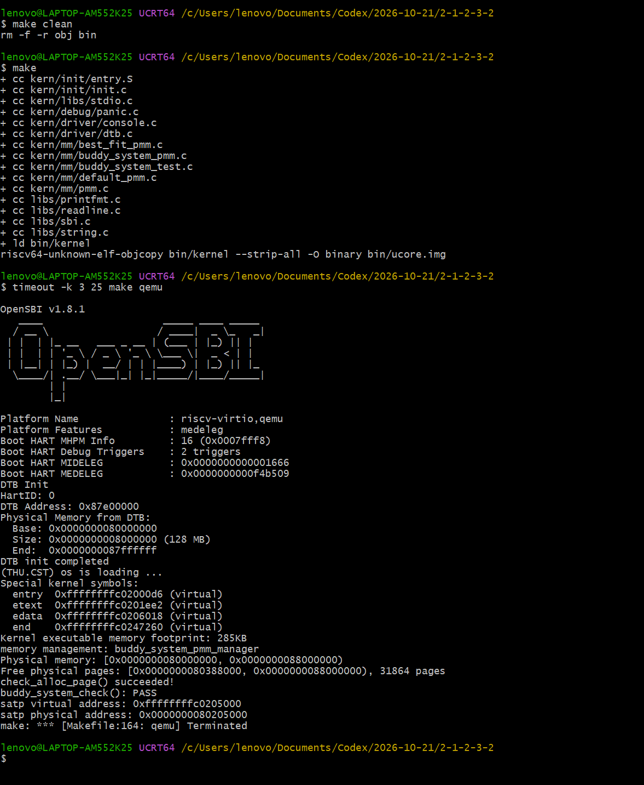

#### First-Fit、Best-Fit、Buddy System 的比较

| 维度 | First-Fit | Best-Fit | Buddy System |
| --- | --- | --- | --- |
| 空闲组织 | 单条按地址升序链表 | 单条按地址升序链表 | 按阶分桶，每阶一条链表 |
| 选择策略 | 第一个 `property >= n` | 最小 `property >= n` | 最小满足阶（2 的幂对齐） |
| 分配复杂度 | O(块数) 最坏 | O(块数) | O(log N) |
| 释放复杂度 | O(块数) + O(1) 合并 | O(块数) + O(1) 合并 | O(log N) |
| 内部碎片 | 无 | 无 | 有（向上取整到 2 的幂） |
| 外部碎片 | 有，低地址端易碎 | 比 First-Fit 少 | 有，形态不同 |
| 实现复杂度 | 最低 | 低 | 较高（对齐与伙伴关系） |

三者都实现 `pmm_manager` 的六个接口，切换活动管理器只需改 `init_pmm_manager()` 里的一行
指针。本实验最终活动管理器为 **Best-Fit**；Buddy 作为扩展实现与测试保留在工程中。

---

### 分支任务：GDB 调试页表查询过程

**负责人：** 2513582-张子芊（C）

#### 模块功能描述

本部分对应指导书中的“分支任务：GDB 调试页表查询过程”。调试对象不是 uCore 中的普通 C 函数，而是“正在模拟 uCore 的 QEMU”。通过带调试信息的 QEMU 4.1.1、host GDB 和 guest GDB，观察虚拟 CPU 发生取指访问时，QEMU 如何查询软件 TLB、在 miss 后遍历 Sv39 页表、形成物理地址并填充 TLB。

**主要涉及的 QEMU 函数：**

```c
static int get_physical_address(CPURISCVState *env, hwaddr *physical,
                                int *prot, target_ulong addr,
                                int access_type, int mmu_idx);

bool riscv_cpu_tlb_fill(CPUState *cs, vaddr address, int size,
                        MMUAccessType access_type, int mmu_idx,
                        bool probe, uintptr_t retaddr);

void tlb_set_page(CPUState *cpu, target_ulong vaddr,
                  hwaddr paddr, int prot,
                  int mmu_idx, target_ulong size);
```

#### 实际完成内容

1. 在独立目录完成 QEMU 4.1.1 的调试构建，并确认生成文件带有调试符号、未被 strip，没有执行 `make install`。
2. 定位 QEMU 的 TLB miss、RISC-V 地址翻译和 TLB 填充代码，建立 host GDB 与 guest GDB 调试链路；guest GDB 连接前设置 `set remotetimeout unlimited`。
3. 对内核入口附近的真实取指地址设置条件断点，通过调用栈排除调试器辅助查询，单步记录 `satp`、VPN、PTE、权限、物理页地址和 `tlb_set_page()` 参数。
4. 根据实际报错调整工具和命令：用 `grep` 代替缺失的 `rg`，使用 `-kernel` 启动 uCore，并把 GDB 命令逐行输入以避免 `malformed linespec`。

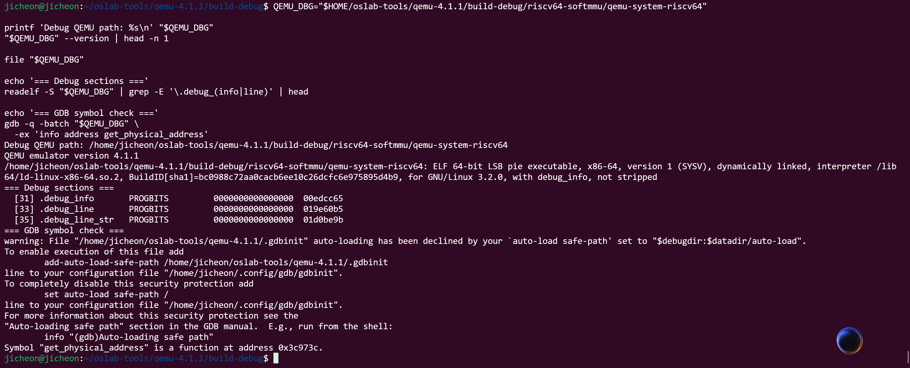

本任务使用的 Prompt 单独保存在 `prompt.md`，报告以下内容只记录完成的操作和观察结果。

#### 1. QEMU 源码调用路径与 Sv39 单步翻译（对应调试要求 1、2）

QEMU 的 TCG 访存辅助代码先按虚拟页和 MMU 索引查询软件 TLB。标签不匹配时进入慢路径 `tlb_fill()`，RISC-V CPU 类注册的回调继续进入 `riscv_cpu_tlb_fill()`，再调用 `get_physical_address()`。

`get_physical_address()` 的关键分支包括：

1. M 模式直接访问或未启用 MMU时执行恒等映射；
2. 从 `satp` 取得分页模式与根页表 PPN；
3. 根据 Sv32/Sv39/Sv48/Sv57 选择层数、索引宽度和 PTE 大小；
4. 循环计算 `pte_addr = base + idx * ptesize` 并读取 PTE；
5. 检查 `V/R/W/X`、访问权限、A/D 位和超级页对齐；
6. 非叶子项更新下一级页表基址，叶子项形成物理页地址；
7. 翻译成功后由 `tlb_set_page()` 写入 QEMU 软件 TLB，失败则设置相应异常。

为了减少无关中断，使用内核入口附近必然发生的取指地址作为目标：

```text
address     = 0xffffffffc02000d8
access_type = MMU_INST_FETCH
mmu_idx     = 1
```

调用栈实测为：

```text
#0 get_physical_address
#1 riscv_cpu_tlb_fill
#2 tlb_fill
```

断点处的 `satp` 为：

```text
env->satp = 0x8000000000080205
```

最高 4 位 `8` 表示 Sv39；根 PPN 为 `0x80205`，根页表物理地址为 `0x80205000`。目标虚拟地址拆分为：

| 字段 | 数值 |
|------|------|
| `VPN[2]` | `511` |
| `VPN[1]` | `1` |
| `VPN[0]` | `0` |
| 页内偏移 | `0xd8` |

第一轮页表遍历实测：

```text
i        = 0
pte_addr = 0x80205ff8
pte      = 0x200000cf
ppn      = 0x80000
```

手工计算 `0x80205000 + 511 × 8 = 0x80205ff8`，与 QEMU 一致。PTE 低位 `0xcf` 表示 `V/R/W/X/A/D` 置位，`U/G` 未置位。根级即遇到叶子项，因此本次使用 1 GiB 超级页，不再读取后两级页表。

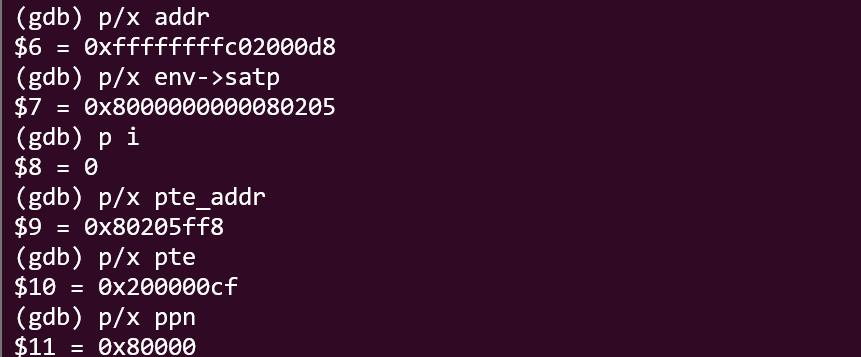

QEMU 返回的页级映射为：

```text
address         = 0xffffffffc02000d8
pa              = 0x80200000
address & 0xfff = 0xd8
prot            = 0x7
mmu_idx         = 1
```

最终物理字节地址为 `0x80200000 + 0xd8 = 0x802000d8`，`prot=0x7` 表示读、写、执行权限。

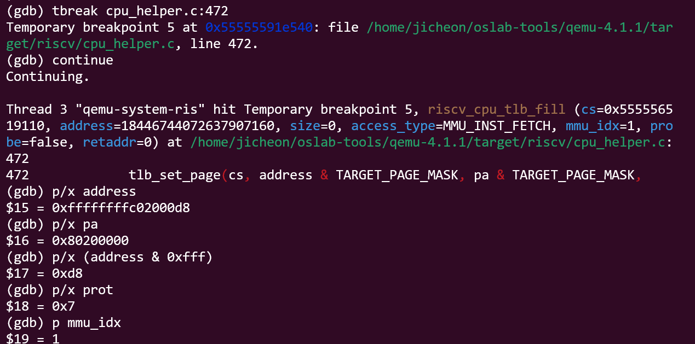

#### 2. TLB、Bare 模式与真实 CPU 的区别（对应调试要求 3、4）

在 `accel/tcg/cputlb.c` 中可以定位 TCG 软件 TLB 的 miss 慢路径；本次动态调试实际命中了 `tlb_fill()`、`riscv_cpu_tlb_fill()`、页表遍历以及 `tlb_set_page()`。这证明目标映射在 miss 后被计算并写入软件 TLB。本次没有单独记录同一页后续访问的 fast-path hit，因此不把“第二次访问更快”写成实测结论。

QEMU 源码中，M 模式直接访问或未启用 MMU 时令 `physical = addr`，不遍历页表；Sv39 模式则使用 `satp` 和 VPN 逐级读取 PTE。本次对 Sv39 完成了动态调试；Bare 仅完成源码分支分析，没有把 guest GDB 的辅助内存查询冒充成真实 CPU 访存。

真实 CPU TLB 是处理器内部硬件结构，与流水线、权限检查和异常机制配合；QEMU TLB 是宿主机内存中的软件结构，用于缓存 guest 虚拟页的翻译。两者逻辑上都利用局部性并需要在页表变化后失效，但实现载体、命中代价和并发机制不同。

#### 3. 调试记录与 AI 协作（对应调试要求 5、6）

- 调试器为了读取 guest 内存也会请求地址翻译，所以“断点命中”本身不能证明发生了 CPU 访存，必须检查调用栈。
- Sv39 虽称三级页表，本次根级 PTE 已是超级页叶子，因此循环只执行一轮。
- `pa=0x80200000` 是页基址，必须加上 `0xd8` 页内偏移才得到最终字节地址。
- `set remotetimeout unlimited` 解决的是双 GDB 暂停关系导致的远程等待问题，而不是页表算法错误。

关键修复包括用 `grep` 替代缺失的 `rg`、把 `-device loader` 改为 `-kernel`、用调用栈排除调试器辅助访问、逐行执行 GDB 命令，以及设置无限远程等待时间。任务 Prompt 记录在 `prompt.md`。

---

### 功能模块二·扩展任务 Challenge：任意大小的内存单元 SLUB 分配算法

**负责人：** 2513582-张子芊（C）

#### 模块功能描述

SLUB 在现有页分配器上构建两层内存管理：第一层通过 `alloc_page()`/`free_page()` 管理 4 KiB 后备页；第二层把每个后备页切分为固定大小对象，对外提供小对象分配与释放接口。该 Challenge 的目标是展示“页分配器之上继续管理小对象”的主体思想，而不是复刻完整 Linux SLUB。

**实现和接入的函数：**

```c
void slub_init(void);
void *slub_alloc(size_t size);
void slub_free(void *ptr);
void slub_check(void);
```

实现文件为 `kern/mm/slub.c`、`kern/mm/slub.h`。`kern_init()` 先调用 `pmm_init()`，再调用 `slub_init()` 和 `slub_check()`；顺序不能颠倒，因为 SLUB 的后备页来自已经初始化完成的 PMM。

#### 数据结构与实现设计

本实现使用九个 2 的幂大小类：

```text
8、16、32、64、128、256、512、1024、2048 字节
```

请求通过 `slub_size_to_class()` 选择能够容纳它的最小大小类。例如 32 字节请求进入 32 字节 cache，33 字节请求进入 64 字节 cache。

每个大小类由一个 `struct slub_cache` 管理，其中分别维护：

- `partial_slabs`：仍有空闲对象的页面；
- `full_slabs`：对象已经全部分配的页面；
- `nr_slabs`：该大小类当前占用的后备页数量。

每个后备页开头存放 `struct slub_page`，记录 magic、大小类编号、对象容量、已分配对象数、页内 freelist 和链表节点。元数据之后的空间按当前对象大小对齐并切分。空闲对象的第一个机器字直接保存下一空闲对象指针，因此不再为 freelist 单独申请内存，也决定了 RV64 下最小大小类为 8 字节。

#### 关键操作流程

1. `slub_init()` 初始化九个 cache 的对象大小、partial/full 链表及页面计数；重复调用不会重复初始化。
2. `slub_create_page()` 从 PMM 申请一个 4 KiB 页面，在页首建立元数据，把剩余空间按一个大小类切分为对象并建立 freelist，最后加入 partial 链表。
3. `slub_alloc()` 先选择大小类，再从该类第一个 partial 页面弹出一个对象；没有 partial 页面时创建新页。页面用满后从 partial 移到 full。
4. `slub_free()` 将对象地址向下按页对齐以定位所属 `slub_page`，检查 magic、大小类、对象边界、重复释放和计数后把对象压回 freelist。原 full 页面释放一个对象后返回 partial；当 `inuse` 变为 0 时，删除页元数据并通过 `free_page()` 把整个后备页归还 PMM。

#### 实际完成内容

1. 阅读 PMM、页描述符、链表和内核初始化接口，新增 `kern/mm/slub.c`、`kern/mm/slub.h`，并在 `pmm_init()` 之后接入 SLUB 初始化与自检。
2. 实现九个大小类以及 slab 页内元数据、对象 freelist、partial/full 链表，保证对象使用最小可容纳的大小类。
3. 完成分配、释放和状态转换：满 slab 进入 full，释放后回到 partial，完全空闲时归还后备页；同时检查非法地址、非对象边界和重复释放。
4. 修正当前内核布尔常量兼容问题后完成编译，并用 `slub_check()` 验证边界大小、对齐、对象隔离、对象复用、跨页分配和空页回收。

本 Challenge 的“实现 Prompt”和“测试 Prompt”单独保存在 `challenge_prompt.md`。

#### 功能边界与受限条件

本实现的“任意大小”指在预设小对象范围内选择合适大小类，并不表示能够分配任意大的连续字节数。具体边界如下：

| 边界 | 当前行为与影响 |
|---|---|
| 支持的请求范围 | `1~2048` 字节；`size==0` 或 `size>2048` 返回 `NULL` |
| 大对象 | 不支持超过 2048 字节的对象，也不把多个页面拼成一个大对象 |
| 页面模型 | 一个 slab 固定使用一个 4 KiB 后备页，页首元数据会占用部分空间 |
| 大小类 | 仅九个 2 的幂大小类；请求向上归入最近大小类，存在内部碎片，例如 33 字节实际占 64 字节 |
| 地址模型 | 依赖当前内核的直接映射、4 KiB 页大小以及页面对齐，可由对象地址向下对齐找到页首元数据 |
| 并发 | 按本实验单核顺序执行场景设计，没有锁、原子操作、per-CPU cache 或多核一致性处理 |
| 空页策略 | 最后一个对象释放后立即归还页面，没有保留空 slab 作为热缓存，节省页面但可能增加反复申请/释放开销 |
| 错误处理 | 非 SLUB 地址、非对象边界、重复释放和计数损坏使用 `panic()`；没有向调用者返回可恢复错误码 |
| 重复释放检测 | 通过线性遍历 freelist 完成，时间复杂度为 O(该页空闲对象数)，未使用位图 |
| 调试与安全 | 没有红区、poison、对象构造/析构、越界写检测和代际标记；不能替代生产内核分配器 |

此外，当前分配策略直接选择 partial 链表中的第一个页面，没有实现页面着色、利用率分级或复杂回收策略。它能够展示 cache、slab 页、freelist、partial/full 状态和空页回收，但性能与安全能力均受教学实现范围限制。

#### 测试样例设计与有效性

`slub_check()` 在内核启动时按以下场景执行断言：

| 测试样例 | 具体输入或操作 | 检查内容 | 为什么有效 |
|---|---|---|---|
| 大小类边界 | 依次申请 `1、8、9、31、32、33、127、1024、2048` 字节 | 返回非空且至少 8 字节对齐；释放后 PMM 空闲页数恢复 | 同时覆盖最小值、大小类边界两侧和最大支持值，可发现类别选择、对齐和页泄漏问题 |
| 非法尺寸 | `slub_alloc(0)`、`slub_alloc(2049)` | 均返回 `NULL`，不消耗额外物理页 | 直接验证当前接口支持范围的上下边界 |
| 对象隔离 | 申请两个 32 字节对象，分别写入 `0xA5` 和 `0x5A`，再逐字节读取 | 两个地址不同，写入内容互不覆盖 | 可检查对象切分步长、边界和相邻对象独立性 |
| 释放后复用 | 保留一个 32 字节 anchor，释放同页另一个对象后立即重新申请 | 新对象地址等于刚释放地址 | anchor 防止后备页被整体回收，能够单独验证 freelist 的 LIFO 复用行为 |
| 跨页与回收 | 连续申请 128 个 32 字节对象，再全部释放 | 分配时 PMM 空闲页数下降，释放后恢复到初始值 | 单个 slab 页容不下全部对象，因此可强制创建多个后备页并验证跨页分配及完全回收 |

上述测试从接口结果、对象内容和 PMM 空闲页计数三个角度验证主要路径。`slub_check: passed` 只表示这些顺序执行场景全部满足断言，不能扩大解释为所有错误路径和运行环境都已验证。

#### 尚未动态覆盖的测试边界

- 没有在正式自检中主动执行非 SLUB 地址、非对象边界和重复释放，因为当前设计会 `panic()` 并终止本轮内核测试；这些路径已有源码检查，但本次没有分别保存故障注入结果。
- 自检只通过公开分配/释放接口观察行为，没有直接读取内部 `class_index`，也没有直接断言某个 slab 当前位于 partial 还是 full 链表；最小大小类选择和链表状态转换的结论由源码分析与外部行为共同支持。
- 没有覆盖物理页耗尽时 `alloc_page()==NULL` 的完整压力场景。
- 没有遍历 `1~2048` 的每一个尺寸，也没有长时间随机分配/释放压力测试。
- 没有多核或并发分配测试，因为实现本身未提供同步机制。
- 没有检查对象越界写、use-after-free 或释放后页面被重新用于另一个 cache 时的陈旧指针。
- 课程 `make grade` 只覆盖 Page Init 和 Best-Fit；SLUB 的结论来自独立 `slub_check()`，二者证据不能混用。

#### 与 Linux SLUB 的区别

本实现保留“按大小类组织 cache—以页为 slab—页内管理对象—维护满页和可分配页—空页回收”的主体思想，但省略真实 Linux SLUB 的 per-CPU cache、NUMA、并发锁、批量操作、红区、对象构造函数和复杂调试机制，因此适合教学展示，不等同于生产内核分配器。

---

## 五、测试与验证

### 5.1 A：物理内存初始化与硬件内存探测

本次验证使用 WSL2 Ubuntu 24.04.4、SiFive GCC-Metal 10.2.0、QEMU 8.2.2 和其默认 OpenSBI 1.3；与 C 的 QEMU 4.1.1 调试环境分别记录。

| 检查 | 实测结果 | 证据 |
|---|---|---|
| make clean；make -j2 | 构建退出 0，保留 clock skew 警告 | 构建日志（本地留档） |
| QEMU 64 MiB | 15705 初始空闲页，PMM 检查及 SLUB 通过 | 64 MiB（本地留档） |
| QEMU 128 MiB | 31929 初始空闲页，PMM 检查及 SLUB 通过 | 128 MiB（本地留档） |
| QEMU 256 MiB | 64377 初始空闲页，PMM 检查及 SLUB 通过 | 256 MiB（本地留档） |
| 超出启动映射的故障注入 | 独立副本输出指定 panic，未登记空闲区 | 边界日志（本地留档） |
| make grade | Page Init OK、Best-Fit OK、20/20，退出 0 | 评分日志（本地留档） |

正常 QEMU 启动后内核进入框架的无限循环，脚本在 5 秒后结束进程并标记状态 124；这是限时采集日志，不是将其冒充正常退出。成功依据为实际 PMM/SLUB 标志和无 panic。课程 Page Init 包含偏移、npage、描述符对齐、空闲计数、内核/数组保留及往返转换检查。

复现基础测试：在 WSL 的工程 `code/` 目录配置好课程工具链后，依次执行 `make clean`、`make -j2`、`make qemu` 和 `make grade`。Windows 检出后须保证 `tools/grade.sh` 为 LF。原始日志与辅助验证脚本单独在本地留档，不作为报告目录中的提交文件。下方为实验者实际运行时截取的终端图片；未动态覆盖每个 panic 分支。

注意：基础评分只覆盖当前 Page Init/Best-Fit；SLUB 由其自检回归，不能据此宣称 Buddy System 已完成。


#### A 的终端运行截图

实验者在桌面 `lab2/lab2-a-work/code` 工作目录中运行内核，得到以下真实终端截图。物理内存范围为 `[0x80000000,0x88000000)`，初始空闲区为 `[0x80347000,0x88000000)`，共 31929 页；当前管理器为 Best-Fit，物理页分配自检和 SLUB 自检均通过，与上文 128 MiB 日志一致。

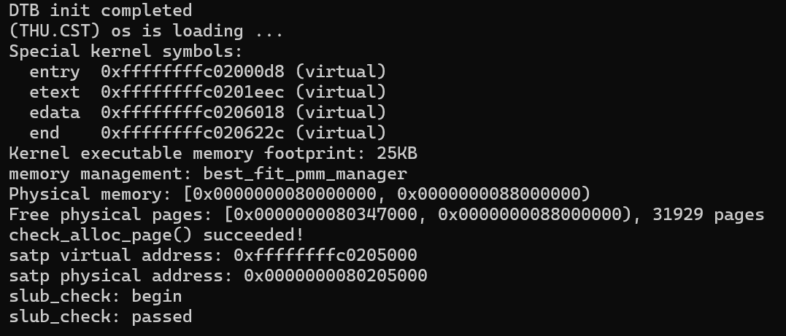

实验者随后在同一工作目录执行 `make grade`。截图显示 Page Init 和 Best-Fit 均为 `OK`，总分为 `20/20`。终端保留了轻微时间戳警告；评分结果以实际检查项为准，不将警告描述为测试失败，也不据此宣称未覆盖的任务已经完成。

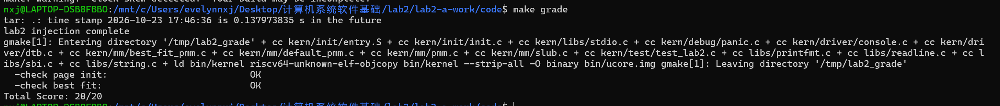

### 5.2 B：First-Fit、Best-Fit 与 Buddy System

| 检查 | 实测结果 | 证据 |
|---|---|---|
| First-Fit 源码与不变量分析 | 完成六个核心函数、链表顺序及分裂合并逻辑分析 | 功能模块二·任务一 |
| Best-Fit：make qemu | best_fit_pmm_manager 启动，check_alloc_page() succeeded | Best-Fit 启动截图 |
| Best-Fit：make test | 六项评分全部通过，grading: 6 / 6 points | Best-Fit 六项测试截图 |
| Best-Fit：make grade | Page Init 与 Best-Fit 均为 OK，总分 20/20 | Best-Fit 评分截图 |
| Buddy System：make qemu | 物理页检查通过，buddy_system_check(): PASS | Buddy System 测试截图 |

上述截图和具体测试场景已放在功能模块二对应任务中，本节不重复插图。Buddy System 验证时临时切换活动管理器，验证完成后恢复 Best-Fit 作为最终活动管理器。

### 5.3 C：QEMU/GDB 调试与 SLUB Challenge

#### 干净构建

合并 A、B、C 代码后执行 `make clean` 和并行构建，结果为：

```text
Build status: 0
bin/kernel: ELF 64-bit LSB executable, UCB RISC-V,
            with debug_info, not stripped
```

#### 内核运行与 SLUB 自检

在代码目录执行 `make qemu`，内核先完成 PMM 检查，再进入 `slub_check()`。实际输出为：

```text
check_alloc_page() succeeded!
satp virtual address: 0xffffffffc0205000
satp physical address: 0x0000000080205000
slub_check: begin
slub_check: passed
```

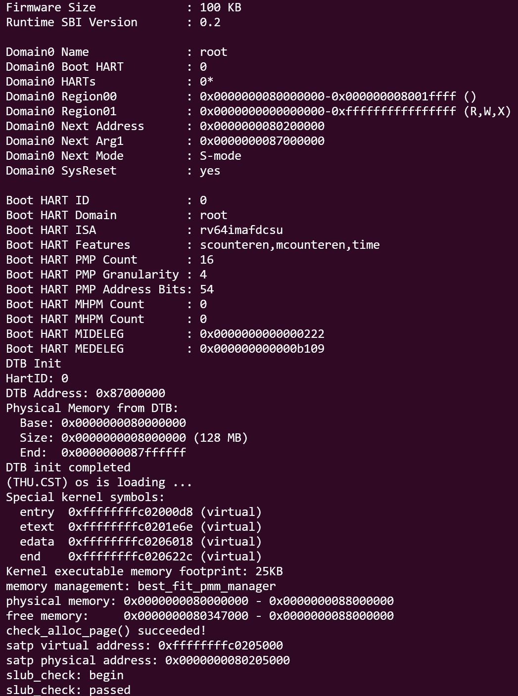

自检内部依次覆盖大小类边界和无效尺寸、相邻对象隔离、释放后复用、跨页分配与空页回收。每个阶段释放对象后都用 `nr_free_pages()` 核对后备页是否全部归还。截图中的 `slub_check: passed` 是所有断言执行完成后的唯一成功标志；如果其中任一检查失败，内核会在到达该输出前触发断言。

本次没有把非法释放、重复释放等预期 panic 路径逐项作为动态截图，因为它们会中止一次完整自检；报告对这些内容只作源码防护说明，不将其写成已执行通过的测试。课程评分也不包含 SLUB，故本节的验证证据与 5.4 的基础任务 20/20 分开解释。

### 5.4 合并版本课程评分

评分脚本在临时副本中注入课程测试，并使用当前环境已经验证的 `-kernel bin/ucore.img` 启动方式。最终结果：

```text
check page init: OK
check best fit:  OK
Total Score: 20/20
Grade status: 0
```

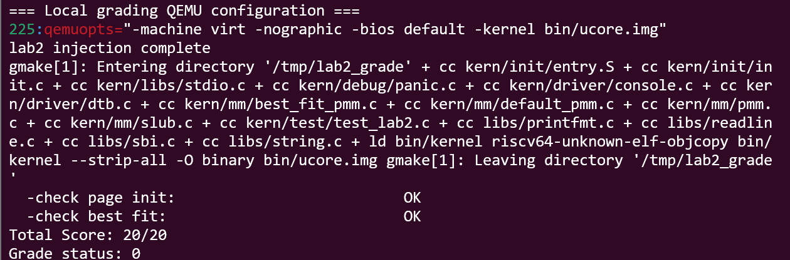

该结果说明当前合并版本的页面初始化和 Best-Fit 通过课程基础测试；SLUB Challenge 由独立的 `slub_check()` 验证。

---

## 六、实验总结与收获

### 6.1 对操作系统的理解

本实验中重要的知识点包括：

1. **物理页管理与小对象管理分层**：PMM 解决按页分配，SLUB 在页内继续切分对象；两者对应不同粒度，不能相互替代。
2. **Sv39 多级页表**：虚拟地址包含多级 VPN 与页内偏移，页表项决定继续查表还是形成叶子映射；超级页允许在高层提前结束遍历。
3. **TLB 与局部性**：TLB 缓存近期页级映射，避免每次访存都读取多级页表；页表更新后必须考虑失效与一致性。
4. **权限与异常**：地址存在映射并不等于允许访问，PTE 权限、访问类型、特权级和 PMP 都可能使翻译失败。
5. **模拟器与硬件的对应关系**：QEMU 用 C 代码和宿主机数据结构模拟 MMU/TLB，使原本不可见的硬件过程能够被源码级调试。

OS 原理中重要但本实验没有完整覆盖的内容包括：多进程独立地址空间、ASID 与上下文切换、TLB shootdown、多核一致性、换页、页面置换、写时复制以及真实内核 SLUB 的并发和 NUMA 优化。

### 6.2 AI 协作开发的经验

本组在使用 AI 协作完成实验时，总结出以下经验：

1. **先按指导书划分任务和边界**：先明确 A、B、C 各自负责的功能模块、Challenge 和报告内容，再为每个可以独立实现、独立验证的任务编写 Prompt，能够减少多人同时修改同一模块造成的冲突。
2. **上下文必须来自真实工程**：Prompt 中的宏定义、数据结构、函数签名、文件位置和可调用接口应从当前代码中核对，不能根据其他版本的 uCore 或 QEMU 凭印象填写。错误的接口信息会直接导致编译失败或调试位置错误。
3. **实现与测试形成闭环**：对于 Best-Fit、Buddy System、SLUB 等编程任务，不仅要描述需要生成的实现，还要明确接口契约、边界情况和测试方法。实现完成后依次进行单文件编译、完整构建、内核运行和课程评分，不能只以代码看起来合理作为完成标准。
4. **根据反馈修正，而不是掩盖问题**：编译错误、运行异常和断点未命中都应先定位原因，再调整代码或 Prompt；不能通过删除断言、修改既有测试或直接填写预期输出来制造通过结果。
5. **区分动态证据、源码分析和推断**：终端输出、调用栈和变量值属于动态证据；没有实际命中的路径只能写为源码分析。报告中应明确这种区别，使结论能够被其他成员和助教复查。
6. **统一合并规范**：每名成员负责填写自己的环境、实现说明、Prompt 和测试结果，最终合并时统一标题、图片路径、接口名称和术语，并重新执行完整测试，确认单独正确的模块组合后仍能正常工作。
